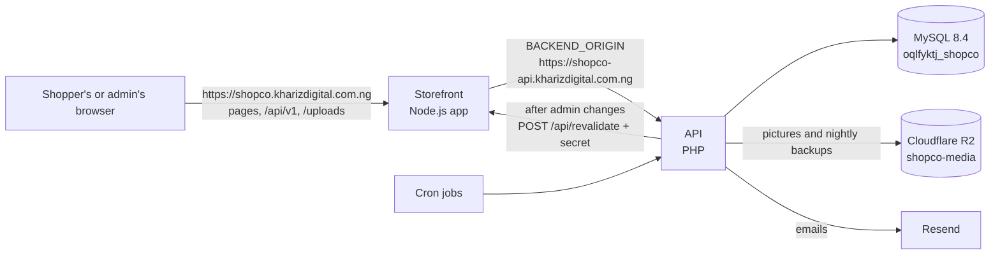

# Deployment runbook: Shop.co on Truehost (cPanel)

The exact steps used to put the demo shop online, with the real addresses and the problems met on
the way. Follow it top to bottom for a fresh deployment; "Updating later" covers new versions.
The general guide for any cPanel host is `deploy/cpanel/README.md`; this file is the record of
**this** host. No passwords or keys are written here.

**Status:** in progress (see the log at the end).

## The setup at a glance

| What | Value |
|---|---|
| Host | Truehost, Web Hosting **Starter** (cPanel, LiteSpeed, CloudLinux) |
| Account (home folder) | `oqlfyktj` → `/home/oqlfyktj` |
| Main domain | `kharizdigital.com.ng`: the owner's company site and email. **The shop never touches it** (`public_html`) |
| Storefront | `https://shopco.kharizdigital.com.ng` (Node.js app in `/home/oqlfyktj/shopco-web`) |
| API | `https://shopco-api.kharizdigital.com.ng` (PHP, document root `/home/oqlfyktj/shopco-api/public`) |
| Database | MySQL **8.4**, database and user both `oqlfyktj_shopco`, host `localhost` |
| PHP | 8.3 (MultiPHP), all needed extensions present; OPcache not available in the panel |
| Node.js | Setup Node.js App, versions up to 26 (20 or newer needed) |
| Pictures | Cloudflare R2, bucket `shopco-media` (the same keys as the PC) |
| Email | Resend, domain `shopco.kharizdigital.com.ng`, sender `orders@shopco.kharizdigital.com.ng`, replies to `khariz.digital@gmail.com` |
| Server location | Dallas, USA (IP `102.203.116.19`) |

**Why the email is on the subdomain:** the main domain is kept free for the company's own email.
Resend's free plan allows one domain, so later demos either share this one or need a paid plan.
No mailbox exists for `orders@...`; `MAIL_REPLY_TO` sends replies to the Gmail.

**Redis (Upstash) is not used:** the server is in Dallas and the Upstash database was in Cape Town,
slower than the 150 ms the shop allows per reply, and on one server the built-in file cache is faster.

## 0. On the PC, before each deployment

1. Commit everything (the build only takes committed code).
2. Build the two upload files (about 5 minutes; they land in `Desktop\shopco-cpanel`):
   ```powershell
   powershell -ExecutionPolicy Bypass -File deploy/cpanel/build.ps1 -ApiUrl https://shopco-api.kharizdigital.com.ng
   ```
3. **First deployment only:** make the clean copy of the database (products, settings, coupons,
   banners and administrators; no test customers or orders):
   ```powershell
   php backend/scripts/export_for_host.php
   ```
   It writes `backend/storage/backups/for-host-<date>.sql.gz` and lists the administrators it keeps.
   Before running it, set a real contact email in admin → Store settings: it appears in every email's
   footer and the storefront's.
4. **The API's settings file** (`.env`): start from `deploy/cpanel/env.cpanel.example` and fill in the
   values in the table above. The secrets come from: database password (cPanel, step 2), R2 keys (the
   PC's `backend/.env`), Resend key (resend.com → API Keys), `REVALIDATE_SECRET` (any random 48
   characters: `php -r "echo bin2hex(random_bytes(24));"`, the same value goes in the Node.js app).
   The filled copy from the first deployment is kept on the PC at
   `Desktop\shopco-cpanel\api-settings\.env`, with `node-app-variables.txt` beside it. Keep both private.

## 1. Domain, subdomains and https

1. Buy the domain with the hosting (Truehost's nameservers, so no DNS setup is needed). A new `.com.ng`
   took several hours before it answered at all.
2. cPanel → **Domains** → **Create a New Domain**, twice. Untick **Share document root** both times.
   - `shopco.kharizdigital.com.ng`, document root: keep cPanel's suggestion (`shopco.kharizdigital.com.ng`).
     It must not be `shopco-web`: the Node.js app folder and the document root can't be the same.
   - `shopco-api.kharizdigital.com.ng`, document root: type **only** `shopco-api/public`.
     **Don't type `/home/oqlfyktj/...`:** the box is already inside the home folder, and a full path
     creates `/home/oqlfyktj/home/oqlfyktj/shopco-api/public`. If that happens: Domains → **Manage** →
     **New Document Root** `shopco-api/public`, then delete the stray `home` folder.
3. **https:** this cPanel has no "SSL/TLS Status" page; the free certificates arrive by themselves,
   which took about a day for the new domain. Check by opening both addresses with `https://`.

## 2. Check the host and create the database

1. Upload `deploy/cpanel/check-host.php` to the `shopco.kharizdigital.com.ng` folder, open it, keep the
   result, **delete it**. Leave `cgi-bin` and `php.ini` in that folder alone (cPanel makes them).
   (Its R2 line used to say NO because Cloudflare's bare test address has an expired certificate;
   fixed in the checker. The real R2 check is System status, step 7.)
2. cPanel → **MySQL Database Wizard**: database `shopco`, user `shopco` (both become `oqlfyktj_shopco`),
   **ALL PRIVILEGES**. Avoid `#` and quote marks in the password.
3. phpMyAdmin's first page shows the server version (MySQL 8.4.13 here).

## 3. Put the API online

1. **File Manager** → Settings → tick **Show Hidden Files**.
2. In `/home/oqlfyktj/shopco-api`, upload `shopco-api.zip`, **Extract** it there, delete the zip.
3. Upload the `.env` into `/home/oqlfyktj/shopco-api` (next to `src` and `public`, **not** inside `public`).
4. **PHP:** this cPanel has **MultiPHP**, not "Select PHP Version".
   - **MultiPHP Manager:** `shopco-api.kharizdigital.com.ng` on PHP 8.2 or newer.
   - **MultiPHP INI Editor** → Basic Mode → location `shopco-api.kharizdigital.com.ng`:
     `upload_max_filesize` 8M, `post_max_size` 10M → Apply.
5. **phpMyAdmin** → `oqlfyktj_shopco` → **Import** → the `for-host-<date>.sql.gz` file → Import.
   Green "Import has been successfully finished"; 35 tables.
6. **Database update check:** cPanel → **Cron Jobs** → once per minute, command:
   ```
   /usr/local/bin/php /home/oqlfyktj/shopco-api/migrations/migrate.php > /home/oqlfyktj/shopco-api/storage/logs/migrate.log 2>&1
   ```
   Wait 2 minutes, delete the job, read `storage/logs/migrate.log`: "Database is up to date".
7. Open `https://shopco-api.kharizdigital.com.ng/api/v1/health`: it must show `"status":"healthy"`.
   - **403 Forbidden on every address** (found 8 Nov 2026): LiteSpeed applied `shopco-api/.htaccess`
     ("refuse everything", meant for hosts that serve the whole folder) to `public` too. Fixed in the
     package: `public/.htaccess` now starts with `Require all granted`. For a package built before the
     fix, upload the new `public/.htaccess` over the old one.

## 4. Put the storefront online

1. **Clear the shop's web folder** `/home/oqlfyktj/shopco.kharizdigital.com.ng`: delete `check-host.php`
   and any `index.html`/`index.php`. **Keep** `cgi-bin`, `.htaccess` (Setup Node.js App writes its
   instructions there), `.user.ini`, `php.ini` and `.well-known` (renews the https certificate).
2. In `/home/oqlfyktj`, make the folder `shopco-web`, upload `shopco-web.zip` into it, **Extract**,
   delete the zip. Expect `server.js`, `package.json`, `node_modules`, `public` and the hidden `.next`.
   **Keep `node_modules`:** it holds everything the app runs on, including the Linux picture library.
3. cPanel → **Setup Node.js App** → **Create Application**:

   | Setting | Value |
   |---|---|
   | Node.js version | 20.x |
   | Application mode | Production |
   | Application root | `shopco-web` |
   | Application URL | `shopco.kharizdigital.com.ng` (nothing after it) |
   | Application startup file | `server.js` |

   Environment variables (from `node-app-variables.txt`): `NODE_ENV=production`,
   `BACKEND_ORIGIN=https://shopco-api.kharizdigital.com.ng`, `REVALIDATE_SECRET` (the same value as the
   API's `.env`), `UV_THREADPOOL_SIZE=2`, `VIPS_CONCURRENCY=1`.
   **Don't click "Run NPM Install".** Create, then Start or Restart.
   (CloudLinux sometimes refuses an app folder that has its own `node_modules`; it didn't here. If it
   ever does: rename it `node_modules_bundle`, create the app, then move its contents into
   `/nodevenv/shopco-web/20/lib/node_modules`, the folder cPanel's new `node_modules` link points to.)
4. Open `https://shopco.kharizdigital.com.ng`. Checked from outside on 8 Nov 2026: pages answer in about
   1 second, `/api/v1` and `/uploads` reach the API through the shop's address, pictures come from R2
   (`X-Upload-Source: s3`) and are resized on the host, and `/api/revalidate` refuses a call without the
   secret (401), which shows the secret is set.

### Admin sign-in on the live shop

Sign in at `https://shopco.kharizdigital.com.ng/admin`. The export carries the PC's administrators
with their PC passwords: `admin@shopco.ng` (the owner) and `achmad.hakim@shop.co` (a test account:
remove it). To give an account a new password without the old one:

1. On the PC, make the scrambled form (bcrypt, cost 12, as the shop uses):
   `php -r "echo password_hash('NEW-PASSWORD', PASSWORD_BCRYPT, ['cost' => 12]);"`
2. phpMyAdmin → `oqlfyktj_shopco` → **SQL** tab:
   ```sql
   UPDATE `users` SET `password_hash` = '<the $2y$12$... text>' WHERE `email` = 'admin@shopco.ng' AND `role` = 'admin';
   ```
   It should say "1 row affected". Then change it again in admin → My account if you like.

**Give every admin a real email.** Admin emails (new orders, "customer says they paid", payments)
go to every active admin, and the clean-up confirmation code goes to the admin who asks for it. The
PC's accounts had made-up addresses (`admin@shopco.ng`, `achmad.hakim@shop.co`), which may be other
people's real domains. Admin → My account can't change an email, so use phpMyAdmin → SQL:

```sql
UPDATE `users` SET `email` = 'khariz.digital@gmail.com' WHERE `email` = 'admin@shopco.ng' AND `role` = 'admin';
UPDATE `users` SET `status` = 'suspended' WHERE `email` = 'achmad.hakim@shop.co' AND `role` = 'admin';
```

Then sign in with the Gmail address and the same password. A suspended admin can't sign in and gets
no emails; it can be switched back with `status = 'active'`.

## 5. Scheduled jobs (Cron Jobs)

cPanel → **Cron Jobs**. Clear **Cron Email** first (else an email every run). For each job, type the
time into the five boxes (Minute, Hour, Day, Month, Weekday) instead of using Common Settings, which has
no 10-minute choice: every 5 minutes is `*/5 * * * *`, every 10 is `*/10 * * * *`, 03:00 daily is
`0 3 * * *`, 02:30 daily is `30 2 * * *`. The server clock is the host's (USA), not Lagos time.
Add `>/dev/null 2>&1` at the end of each command.

| How often | Command |
|---|---|
| Every 5 minutes | `/usr/local/bin/php /home/oqlfyktj/shopco-api/scripts/process_outbox.php --limit=500 --max-seconds=50 --rate=8` |
| Every 10 minutes | `/usr/local/bin/php /home/oqlfyktj/shopco-api/scripts/expire_pending_orders.php` |
| Daily 03:00 | `/usr/local/bin/php /home/oqlfyktj/shopco-api/scripts/check_database.php` |
| Daily 02:30 | `/usr/local/bin/php /home/oqlfyktj/shopco-api/scripts/backup.php && /usr/local/bin/php /home/oqlfyktj/shopco-api/scripts/backup_to_bucket.php` |

*Status: to be added.*

## OPcache (faster API)

OPcache keeps PHP's compiled code in memory, so the API answers about twice as fast. On this host
it is part of PHP but may be switched off server-wide; a panel setting can't switch on what the host
switched off.

1. **Check first:** admin → Store settings → dev mode → **System status**: the PHP line says
   "OPcache on" or "off". (Since 9 Nov 2026 this check also works on hosts that hide OPcache's own
   status; before, it could say "off" when it was on.)
2. **If off, try the panel:** cPanel → **MultiPHP INI Editor** → **Editor Mode** → location
   `shopco-api.kharizdigital.com.ng` → add the line `opcache.enable=1` → **Save**. Check System status again.
3. **Still off: ask Truehost:** *"Please enable OPcache (the Zend OPcache extension) for PHP 8.3 on my
   account oqlfyktj, for the domain shopco-api.kharizdigital.com.ng."* Nothing else needs changing:
   after an update, OPcache notices changed files by itself.

## Card payments in test mode (sandbox)

The demo shows Monnify and Kora with their **sandbox** keys (the same test keys as the PC): the
checkout, payment pages and automatic confirmation all work, and no real money moves. Without keys a
gateway isn't offered at all, which is why the shop first showed WhatsApp only.

1. In the API's `.env`: `PAYMENT_MONNIFY_ENABLED=true`, `PAYMENT_KORA_ENABLED=true`, and every
   `MONNIFY_...` and `KORA_...` line from the PC's `backend/.env` (`MONNIFY_API_BASE_URL=https://sandbox.monnify.com`,
   Kora's `pk_test_`/`sk_test_` keys). The Desktop copy (`api-settings\.env`) has them.
2. Admin → Settings → **Payment methods**: both show as **sandbox**; choose which one **Pay now** uses.
3. **Monnify only:** in the Monnify dashboard (sandbox), set the webhook address to
   `https://shopco.kharizdigital.com.ng/api/v1/webhooks/monnify`. Kora needs nothing: each payment
   tells Kora to notify `APP_URL/api/v1/webhooks/kora`.
4. Test with the gateways' test cards (shown on their sandbox payment pages and in their docs).
5. System status warns that test keys are in use: expected for the demo. For real customers, replace
   them with live keys (`MONNIFY_API_BASE_URL=https://api.monnify.com`, `sk_live_` for Kora).

## 6. Final checks

*To be written as they are done.* (Admin → dev mode → System status: visitor addresses show your own
address, storage `s3 · writable`, email Resend; a test order from a phone on mobile data; one picture
upload; UptimeRobot on the health address and the shop.)

## How the storefront and the API work together

The shop is two programs on the same hosting account:

- **The storefront** (Next.js, Node.js app in `shopco-web`): every page shoppers and the admin see.
  It holds no data of its own.
- **The API** (PHP in `shopco-api`): all data and rules: products, carts, orders, payments, sign-in,
  admin actions, emails. It talks to the MySQL database and to Cloudflare R2, Resend and (later) the
  payment gateways.



**The browser only ever talks to the shop's address.** Calls to `/api/v1/...` and `/uploads/...` on
`shopco.kharizdigital.com.ng` are passed on by the storefront to the API's address (`BACKEND_ORIGIN`,
set in Setup Node.js App; the rules are in `next.config.mjs`). Because everything is on one
address, the sign-in cookie belongs to the shop's address, is hidden from JavaScript (HTTP-only)
and needs no extra settings. The API's own address still works directly (for the health check and
uptime monitors) but shoppers never see it.

### The main flows

**1. Opening a page.** The storefront builds the page on the server, asking the API for the
catalogue, banners and settings (`lib/server-api.ts`), for every visit, and tells the browser not to
keep the page. The API answers quickly from its own catalogue cache in files on the host (Redis isn't
used), which every admin change clears.

**2. Pictures.** A product picture's address is `/uploads/<name>.webp`. The storefront passes it to
the API, which reads it from R2 and sends it back with long cache times. Pictures on pages go
through `/_next/image`, which resizes them for the screen with the picture library (sharp) and keeps
each size for a day.

**3. Shopping and signing in.** Cart, sign-in, checkout and order tracking run in the browser and
call `/api/v1/...` on the shop's address. The storefront adds the visitor's address
(`X-Forwarded-For`) when it passes calls on; the API believes it only from addresses in
`TRUSTED_PROXIES`, which is why step 6 checks "Visitor addresses" (limits on sign-in attempts and
orders are counted per visitor).

**4. An order.** Checkout → the API creates the order, reserves the stock and queues the emails
(order received to the customer, new order to the admins). Each email gets one quick attempt
through Resend right after the answer is sent; the `process_outbox` cron job sends anything left
or retried. Unpaid orders expire after their deadline (the `expire_pending_orders` job) and their
stock is released.

**5. WhatsApp payment.** The customer transfers the money and taps "I've sent the transfer" → the
admins get an email → an admin checks the bank and confirms the payment in admin → the customer gets
"Payment received" and a receipt, and the order moves on to packing, shipping and delivery, each
with its own email. Card payments (Kora, Monnify) are off until their keys are added.

**6. Admin changes.** Saving a product, banner, coupon or setting in admin → the API clears its
catalogue cache and moves the storefront version → any page opened afterwards shows the change, and
pages already open notice it within about 5 seconds (each asks `/api/v1/storefront/version` while
visible, and at once when the shopper returns to the tab) and reload their content in place, without
the shopper refreshing. Order tracking also checks its order every 5 seconds. (The API still calls
the storefront's `/api/revalidate`; since pages are built per visit it no longer matters.) A live
stream (SSE) isn't used for this: each open stream holds one of the plan's 20 PHP processes.

**7. Every night and day.** `backup.php` saves the database on the host and `backup_to_bucket.php`
copies it to R2 under `backups/`. `check_database.php` emails the admins only if the database needs
attention (nothing is ever deleted without the admin's password and an emailed code).

**8. Watching.** UptimeRobot checks the health address and the shop every 5 minutes; its visits also
keep the Node.js app from being put to sleep by the host.

## Updating later

1. Commit, then build (step 0.2). Don't export the database again: it would replace real data.
2. **API:** upload and extract `shopco-api.zip` over `/home/oqlfyktj/shopco-api` (`.env` and
   `storage` aren't in the zip, so they're kept). If the update changed the database, run the update
   check from step 3.6.
3. **Storefront:** delete the old `.next` folder in `shopco-web`, upload and extract `shopco-web.zip`
   over it, then **Restart** in Setup Node.js App.
4. Don't update during a client demo: pages can fail for a few minutes.

## Problems met and their fixes

| Date | Problem | Fix |
|---|---|---|
| 7 Nov 2026 | The new domain didn't exist on the internet for hours | Wait; `.com.ng` registration takes time |
| 7 Nov 2026 | check-host.php said R2 was blocked | Cloudflare's bare test address has an expired certificate; checker fixed (124f434) |
| 8 Nov 2026 | API subdomain's folder created at `/home/oqlfyktj/home/oqlfyktj/...` | Full path typed in the document root box; changed to `shopco-api/public` |
| 8 Nov 2026 | No "Select PHP Version" in cPanel | Truehost uses MultiPHP Manager and MultiPHP INI Editor |
| 8 Nov 2026 | API answered 403 Forbidden to everything | Parent `.htaccess` applied by LiteSpeed; `Require all granted` in `public/.htaccess` |
| 9 Nov 2026 | The clean-up code went to `admin@shopco.ng`, not the owner's inbox | The code goes to the admin account's own email, which was the PC's made-up one; changed to the Gmail with SQL, test admin suspended (see "Admin sign-in") |
| 8 Nov 2026 | Admin sign-in failed in the browser although the password was right (the same sign-in worked from the PC with curl) | The storefront reaches the API over the server's public address `102.203.116.19`, which wasn't in `TRUSTED_PROXIES`, so every visitor looked like one person and the failed tries locked sign-in for 15 minutes. Fix: `TRUSTED_PROXIES=127.0.0.1,::1,102.203.116.19` in the API's `.env` (confirm in System status → Visitor addresses) |

## Log

| Date | Done |
|---|---|
| 7 Nov 2026 | Bought Truehost Starter and `kharizdigital.com.ng`; created both subdomains; host check passed; upload files built |
| 8 Nov 2026 | Resend verified on `shopco.kharizdigital.com.ng`, test and sample emails delivered; https live; database created, imported and up to date (MySQL 8.4) |
| 8 Nov 2026 | API online after the 403 fix: `/api/v1/health` answers healthy, database up |
| 8 Nov 2026 | Storefront online in Setup Node.js App (Node 20) on the first try; pages, API calls, R2 pictures and page refresh checked from outside |
| 9 Nov 2026 | Admin sign-in works after the `TRUSTED_PROXIES` fix; Monnify and Kora show as Sandbox in Payment methods |
| 9 Nov 2026 | Admin email moved to the Gmail, cron jobs added, Monnify webhook set; new products and edits show on the shop at once |
| 9 Nov 2026 | Clean-up tick boxes (API) and the hero coupon beside the button (storefront) uploaded; SHOPPER ticked "Show on homepage" in the **live** admin (the PC and live databases are separate, so a code ticked on the PC isn't ticked live). Coupon confirmed on the live homepage. Phone test passed: an admin change shows on an open phone page within about 5 seconds. OPcache still off (MultiPHP INI Editor → Editor Mode, else ask Truehost); upload limits to be set to 8M/10M for the API in Basic Mode |
| 9 Nov 2026 | API and storefront updated together (API first): pages built per visit and never kept by browsers, open pages and order tracking follow changes every 5 seconds, new WhatsApp payment message. No database change and no new cron job. `storefront/version` answers `"0"` until the first admin save after the update, which is expected |
| 9 Nov 2026 | First storefront update by the "Updating later" steps (stop, delete `.next`, upload and extract, start): order tracker fix, WhatsApp waiting page, footer credit. Live and checked; the SHOPPER pill is off the homepage |
