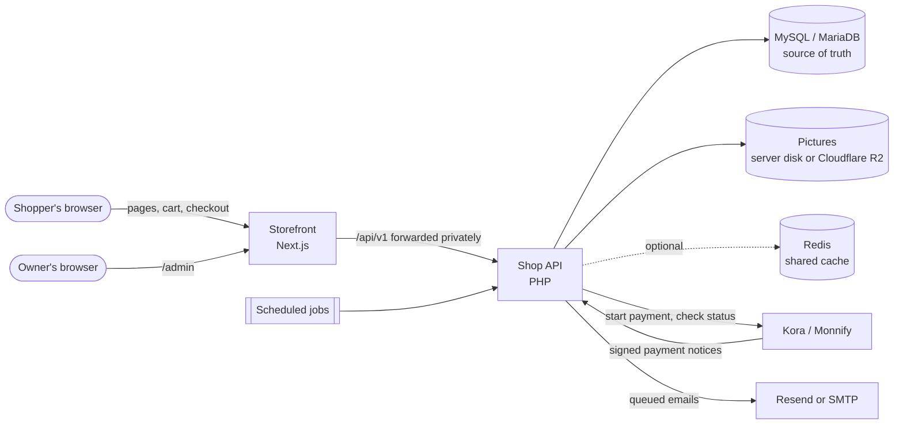
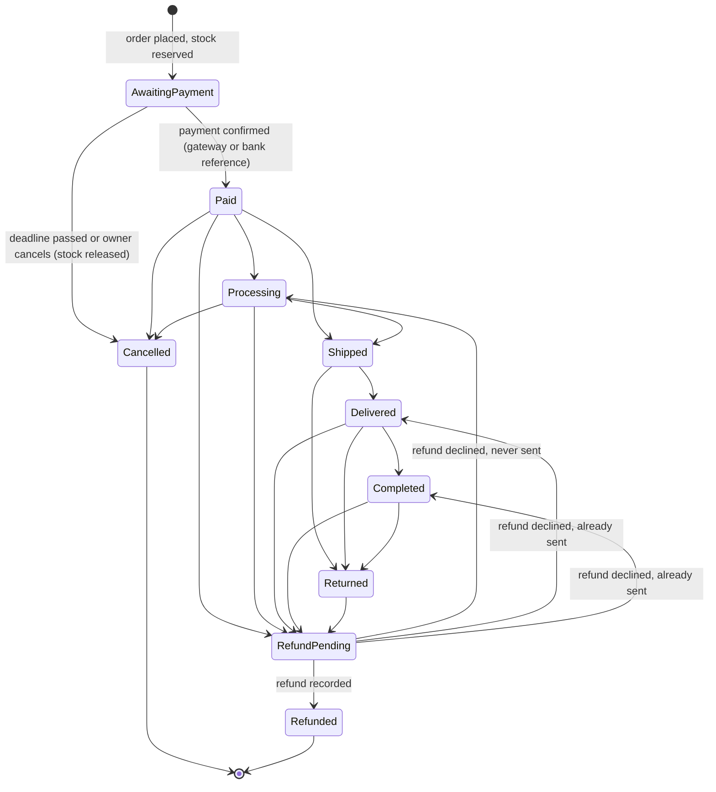
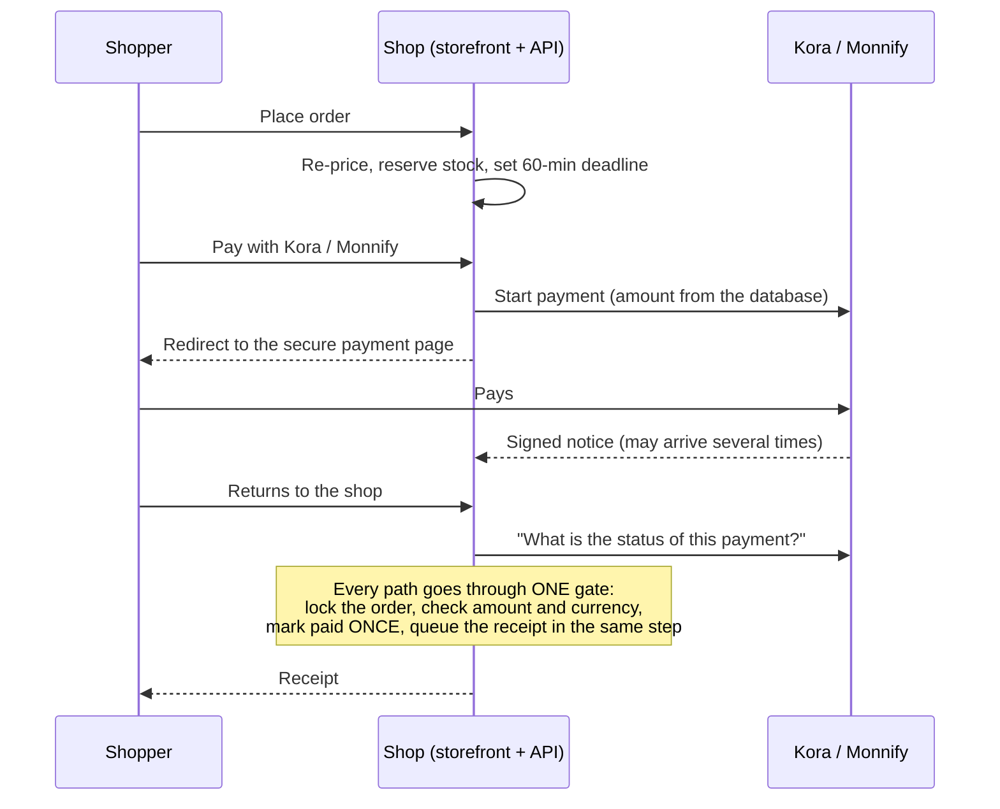

# How Shop.co works

The complete guide to the shop: what shoppers see and do, what the store owner sees and does,
what happens behind the scenes, and the planning that keeps it from breaking under pressure.

It is written for three uses:

- **Proposals to clients.** Every claim here is backed by the code, an automated test or a
  measured load test. Nothing is promised that is not built; planned work is marked
  **Planned**.
- **The explainer videos** (shopper and admin). Section 9 is a ready storyboard.
- **A reference for the team.** File names are given where they help.

> **Keep this file current.** Any change to what shoppers or admins see, to a safeguard, a limit
> or a measured number updates this file in the same commit (changelog at the end).

**Last updated:** 30 October 2026, branch `scalability-phase1`.

---

## Contents

1. [The shop in one minute](#1-the-shop-in-one-minute)
2. [Who uses it](#2-who-uses-it)
3. [The big picture](#3-the-big-picture)
4. [The shopper's journey](#4-the-shoppers-journey)
5. [The store owner's journey (admin)](#5-the-store-owners-journey-admin)
6. [Behind the scenes](#6-behind-the-scenes)
7. [Built not to break: the careful planning](#7-built-not-to-break-the-careful-planning)
8. [Built to grow: scalability](#8-built-to-grow-scalability)
9. [Explainer video storyboard](#9-explainer-video-storyboard)
10. [For proposals: selling points and client FAQ](#10-for-proposals-selling-points-and-client-faq)
11. [What is not built yet (roadmap)](#11-what-is-not-built-yet-roadmap)
12. [Glossary](#12-glossary)
13. [Keeping this guide up to date](#13-keeping-this-guide-up-to-date)

---

## 1. The shop in one minute

Shop.co is a complete online clothing store for Nigeria. Prices are in naira (₦), delivery covers
the 36 states and Abuja (FCT), and customers pay by **card or bank transfer through Kora or
Monnify**, or by **bank transfer arranged on WhatsApp**.

- Shoppers browse, filter, pick a size and colour, and check out **as a guest or with an
  account**. They can track every order from payment to delivery.
- The owner runs everything from a private **admin panel**: products and stock, orders and
  shipping, payments and refunds, promo codes, newsletters, homepage banners, reviews, reports,
  and the health of the system itself.
- Behind the scenes the shop is engineered like a much bigger system:
  - **No overselling:** 100 buyers racing for the last 20 items gives exactly 20 orders.
  - **No double charges:** each payment is applied once, even when the provider sends the same
    notice five times.
  - **No lost or duplicated emails.**
  - **No data deleted without the owner's password and an emailed code.**
  - **Daily backups** that can be restored without technical tools.

The full system has passed 900+ automated checks and a full load test.

---

## 2. Who uses it

| Who | What they do | Where |
|---|---|---|
| **Shopper** (guest or signed-in customer) | Browses, buys, pays, tracks orders, writes reviews, subscribes to offers | The storefront (`/`, `/category`, `/products/…`, `/cart`, `/track-order`, `/orders`) |
| **Store owner / admin** | Runs the store day to day | The admin panel (`/admin`) |
| **The shop's background jobs** | Send emails, release unpaid orders, check the database, take backups | Scheduled scripts on the server (section 6.6) |
| **Payment providers** | Take the money and tell the shop when a payment succeeds | Kora and Monnify (hosted payment pages and signed notifications) |
| **Email service** | Delivers the shop's emails | Resend (recommended) or any SMTP mailbox |
| **Optional services** | Picture storage and a shared cache for bigger set-ups | Cloudflare R2 (ready, not switched on yet), Redis (optional) |

---

## 3. The big picture

How the pieces fit:

- **The browser only ever talks to the storefront.** The storefront forwards API calls to the PHP
  API privately. Sign-in uses secure cookies that page scripts cannot read, and no secret key
  ever reaches the browser.
- **The database is the single source of truth** for prices, stock, orders and payments. Caches
  only speed things up; they are never trusted for money or stock.
- **Prices, delivery fees, discounts and payment status are always decided by the server.** What
  the browser shows is a display, never an instruction.

| Part | Technology | Folder |
|---|---|---|
| Storefront and admin screens | Next.js 16, React 19, TypeScript, Tailwind | `app/`, `components/`, `lib/` |
| API | PHP 8.2 (no framework), MySQLi | `backend/` |
| Database | MySQL 8 or MariaDB 10.4+ | `backend/migrations/` |

---

## 4. The shopper's journey

### 4.1 Arriving: the home page

The home page is built on the server (fast first view, good for search engines) and refreshed at
most once a minute, or immediately after the owner changes something. Top to bottom:

1. **Hero banner:** up to 5 banners set by the owner, rotating every 6 seconds (paused while the
   shopper hovers or uses the keyboard).
   - Each banner has a title, subtitle, button and picture.
   - If a promo code is live, a pill shows *"Special offer: use code … for N% off"*.
   - Real store numbers: products in store, categories, states delivered to.
2. **Brand strip:** a scrolling line of brand names set by the owner (hidden if none).
3. **Flash sale offers:** up to 4 deal products with a live countdown when the owner set an end
   time. The section disappears when the deal ends.
4. **New arrivals** and **Top selling** (ranked by units on paid orders).
5. **Explore by category:** tiles with real product counts.
6. **Browse by dress style:** Casual, Formal, Party, Gym (only styles that exist).
7. **What customers say:** the latest approved reviews, with *"Verified purchase"* where the shop
   found a paid order.

Empty sections hide themselves. **The shop never shows made-up products, prices or reviews.**

**Header** (on every page):
- "Shop" menu with categories and dress styles; "On Sale"; "New Arrivals"; "Track Order".
- Search, wishlist (heart, with count), cart (with count), and account menu.
- On phones, a slide-in menu holds the same links.

**Search with suggestions:**
- After the shopper pauses typing, 5 matching products appear with picture, category and price.
- It understands word beginnings ("shirt" finds "shirts") and ignores filler words.
- It works by keyboard, and has "View all results".

**Footer:**
- Newsletter sign-up.
- Live contact details: email, WhatsApp (opens a chat with a ready message), phone.
- Help links (track an order, shipping, returns, FAQ, contact), company pages, and payment badges
  (Visa, Mastercard, Verve, bank transfer).

### 4.2 Browsing the catalogue (`/category`)

- **Sort:** Best selling, Newest, Price low→high, Price high→low, Top rated.
- **Filters** (a side panel on desktop, a bottom sheet on phones):
  - category (with counts);
  - price range;
  - colours: smart families, so "black" also finds charcoal and "blue" finds navy;
  - sizes (XS→4XL);
  - dress style;
  - "On sale" and "Flash deals".
- Only filter options that actually exist in the current selection are shown.
- Active filters appear as removable chips. 12 products per page.
- Every filter lives in the web address: links can be shared and the Back button works.
- Friendly states throughout: loading placeholders, "No matching products – try removing a
  filter", and a "Try again" button if the connection drops.

**Product cards** show picture, name, rating (only when there are reviews), price, the old price
crossed out on sale items, a "Sold out" badge, and a heart.
- The quick **Add** button checks live stock first.
- One option in stock: added straight away. Several: a quick picker opens.
- It never guesses a size or colour for the shopper.

### 4.3 The product page

- **Gallery:** thumbnails, hover zoom, full-screen view with arrows.
- **Price follows the chosen option:** a size or colour can have its own price. The old price is
  crossed out with a "-N%" badge.
- **Colour and size picker:**
  - sold-out combinations are crossed out;
  - sizes not made in the chosen colour can't be picked;
  - changing colour keeps the size when possible;
  - the page opens on an option that is in stock.
- **Honest stock messages:** "Only 3 left in this size.", "Sold out in this colour and size."
- Quantity up to 20 (or the stock, if lower). **Add to cart**, **Buy now** (straight to the
  cart), **Save to wishlist**, and **Share** (phone share sheet, or copy link / WhatsApp /
  Facebook / X / email).
- On phones a sticky bar keeps the price and "Add to cart" in reach.
- **Tabs:** product details, and *Rating & reviews* sorted by latest or highest rating.
- **"You might also like":** 4 products from the same category.

**Writing a review:**
- Anyone can review, guest or signed in: 1–5 stars, name, email (never published), optional
  title, and the review text (10–2,000 characters).
- Reviews appear only after the owner approves them.
- The **"Verified purchase"** badge is added by the server only for a signed-in reviewer with a
  paid order for that product on their account (or under their confirmed email). A typed email
  proves nothing, so signed-out reviews never get the badge.
- One review per person per product (per account when signed in; a signed-out review that used
  someone's email never stops that person reviewing once they sign in). At most 5 reviews an hour from one connection, to stop
  spam.

### 4.4 Wishlist and cart

- **Wishlist:** a slide-in drawer.
  - Guests: saved on the device.
  - Signed-in customers: also saved to the account and merged on sign-in.
- **Cart:** each line is one exact option (size and colour). Adding the same option again raises
  the quantity, up to the stock.
  - A small pop-up confirms "Added to cart", or explains "Only N can be ordered" or "Sold out".
  - Guests: the cart lives on the device.
  - Signed-in customers: the cart is also saved to the account, so it follows them across
    devices.
  - **Signing in merges carts without doubling anything:** the larger quantity wins.
  - Open tabs stay in step with each other.
- **The cart page re-checks prices and stock with the server** each time it opens. If something
  changed, an amber box says exactly what, for example:
  - "Black Tee (L / Black) sold out and was removed."
  - "Only 2 left of Denim Jacket (M); quantity updated."
  - "Hoodie price dropped to ₦18,000."
- **Promo codes** are applied in the cart:
  - "Code SAVE10 applied (10% OFF)".
  - The code is checked again whenever the cart changes, and removed with a notice if it stops
    applying.
  - It discounts the items, not delivery.
  - At most 30 tries per 10 minutes, so codes can't be guessed.

### 4.5 Checkout: delivery details

"Go to checkout" opens a checkout window right on the cart page.

1. The shopper fills in full name, phone, email, street address, **state** (36 states + FCT),
   city, and an optional delivery note.
   - **"Use my current location"** (optional): the phone asks permission, then a map pin is saved
     with the order so the rider can open it on Google Maps. The typed address is still what the
     order relies on.
   - Signed-in customers get their details and default address pre-filled.
   - What the shopper types is kept if they close and reopen the window.
2. As soon as a state is chosen, the server **re-prices every item from the database, checks
   stock, finds the delivery zone and fee, applies the promo code** and returns the totals.
   - Example: "Delivery to Lagos: Lagos Express · 1–2 days".
   - **The delivery fee can grow with the number of items:** each zone's fee covers the first N
     items, and each extra item adds an amount the owner sets (₦0 by default, so one fee).
   - If several delivery options exist, the shopper chooses one.
   - A state the store doesn't serve is refused clearly. **A free delivery is never applied by
     mistake.**
3. **"Continue to payment"** places the order. The note says *"Your items are reserved for 60
   minutes while you pay."*

**What happens when the order is placed, all in one step that either fully happens or doesn't
happen at all:**

- Every price is recalculated from the database; the browser's numbers are ignored.
- The promo code is re-checked and its use counted.
- **Stock is reserved at once.** Each item's stock is reduced only if enough is left, so two
  people can never buy the last item. If stock ran out, the shopper sees
  *"Insufficient stock … Available: 0"*: always the true number.
- An order number like `ORD-20261030-A1B2C3` is created, with a payment deadline (60 minutes by
  default).
- **The owner is emailed too** (*"New order … (₦…)"*): every active admin, once per order.
- Guests receive a private **order access key** (only a scrambled copy is stored).
- The email *"Order … received – complete your payment"* is queued.

**Double-click and dropped-connection safety:** every checkout carries a unique key. Pressing
the button twice, or retrying after the connection dropped, returns **the same order**: never a
second order, never stock held twice. If the shopper changes the address or the cart before
retrying, the retry is a new order with the new details (never the earlier one returned with old
details).

**A promo code that stops working** (expired or used up while the shopper fills in the form) is
explained in the checkout window with a **"Remove code and continue"** button. A brief network
error never removes a valid code.

**The cart is not emptied yet.** It is cleared only when the payment is confirmed, so a failed or
abandoned payment can be retried on the same order. Coming back to checkout with the same cart
resumes the unpaid order instead of creating a new one.

**Going back to change the delivery details** before paying releases that order's items at once,
so they don't sit reserved while the shopper places the corrected order. Once a payment has been
started the first order keeps its reservation, because money may be on its way.

### 4.6 Checkout: paying

The window changes to **"Complete your payment"**: *"Order ORD-… is reserved until 14:35."*,
the order summary, and for guests the access key with a Copy button.

The shopper sees **two buttons, not a list of gateways**:

| Button | What the shopper does | How it is confirmed |
|---|---|---|
| **Pay now** (card or bank transfer) | Taken to the secure payment page of the store's gateway: **Monnify by default, or Kora if the owner chose it** in Settings. If the chosen one is switched off or has no keys set up, the other is used; with neither ready, only WhatsApp is offered | Automatically: the gateway's signed notice, and the shop asks the gateway directly when the shopper returns |
| **Pay via WhatsApp** (bank transfer) | A WhatsApp chat opens with **only the order number** filled in (the shopper writes the rest). They pay by transfer and tap **"I've sent the transfer"** | By the owner, after seeing the money arrive, by entering the bank reference |

After **"I've sent the transfer"** the page shows **"Awaiting confirmation"** with a loader. It
watches for the owner's confirmation for as long as it stays open (live when live status is on,
otherwise a check every 15 seconds), and **the receipt appears by itself** the moment the owner
confirms. The receipt email goes out at the same moment.

- **Card details are entered only on Kora's or Monnify's pages.** The shop never sees or stores
  them.
- **The amount sent to the provider always comes from the database**, never from the browser.
- Each payment try gets its own reference. If the shopper tries twice, both references stay
  valid, so a late payment on the first try is still matched to the order.
- WhatsApp orders are held for 24 hours instead of 60 minutes, because transfers take longer.
- Tapping "I've sent the transfer" **never marks the order paid by itself.** It tells the store:
  all admins get the email *"Customer says order … is paid (₦…)"*, and the reservation is
  extended.
- **Every confirmed payment emails the owner** (*"Payment received for order …"*), whichever way
  it was paid, in the same database step as the payment.

### 4.7 Coming back from the payment page

The return page **asks the payment provider directly**: *"We confirm every payment directly with
the payment provider."*

- While the payment is pending, it re-checks automatically for about 2 minutes, only while the
  tab is visible, then offers "Check again".
- **With live payment status switched on** (optional, `docs/SSE_CONTRACT.md`), the page keeps a
  connection open and shows "paid" about a second after the payment is recorded, with far fewer
  checks. If live status is off, busy or blocked by a proxy, the page quietly checks the usual
  way. Measured with 64 customers watching at once: browsing stayed as fast, "paid" arrived within
  2 seconds, a closed tab freed its place within about 8 seconds, and after a server restart the
  feature came back by itself.
- **Paid:** confetti and a receipt with items, totals, reference, method and delivery city.
  - The shopper can print it, save it as an image, or share it on WhatsApp.
  - The paid items now leave the cart, exactly once.
- **Pending:** *"Card payments usually confirm within seconds; bank transfers can take a few
  minutes."* Plus a WhatsApp help button.
- **Failed:** *"Payment didn't go through. No money was taken for this attempt."* The order stays
  reserved, with "Try paying again".
- **Expired:** *"This order has expired"*. The items were released, the cart is still there, and
  the shopper places the order again.
- **Paid after it expired:** *"Payment received after the order expired… You don't need to pay
  again."* The owner is alerted to refund or complete it.

Customer emails sent along the way:

- order received;
- payment received (receipt);
- shipped (with courier and tracking);
- cancelled;
- refund recorded.

### 4.8 Tracking and order history

- **Paying from "Track order":** "Pay now", or WhatsApp followed by **"I've sent the transfer"**,
  which opens the same "Awaiting confirmation" page. The order number and checkout email are
  enough, so a customer on another device can pay and report a transfer.
- **Receipts by order number:** on "Track order", the order number plus the checkout email (or
  the access key) finds the order; a paid order shows **"View receipt"**, which opens the full
  receipt to view, print, save as an image or share. An order number alone never opens a receipt,
  because it shows the customer's name, phone and address.
- **Emails at each stage:** order received, payment confirmed, **being prepared**, shipped (with
  the tracking number), **delivered**, and cancelled or refunded.

- **Track order** (`/track-order`): enter the order number **or the courier's tracking number**,
  plus the checkout email (or the access key). On the device used to order, no email is needed.
  - The page shows a status pill and a 5-step progress bar: *Order placed → Payment confirmed →
    Processing → In transit → Delivered*.
  - Once shipped: the courier card with a copyable tracking code and a "Track on the courier's
    site" link.
  - It also shows items, totals, destination and payment details.
  - An unpaid order shows **"Pay now"**.
  - Failed lookups are limited (20 per 15 minutes), so nobody can guess other people's orders.
- **My orders** (`/orders`, signed-in customers):
  - Every order, newest first, with status, courier and tracking, totals, "Pay now" while unpaid,
    and "Details & tracking".
  - **Guest orders are claimed automatically:** when a customer confirms their email by sign-in
    link, every earlier guest order with that email appears here.
- A background check catches payments confirmed later (for example a WhatsApp transfer the owner
  confirms an hour later) and tidies the cart on the shopper's device.

### 4.9 Accounts and signing in

**Accounts are optional.** Guests can do everything. Signing in adds cross-device cart and
wishlist, and the order history.

The sign-in window has three tabs:
- **Sign in:** email and password.
- **Register:** name, email, optional phone, and a password of at least 8 characters.
- **Email link:** a one-time link that works for 15 minutes, no password needed.
  - The answer is the same whether or not an account exists, so the form can't be used to find
    out who shops here.

Protection:
- **Sign-in attempts:** 5 failures per 15 minutes per connection and email, 20 per hour per
  account.
- **Sign-in link requests:** limited per connection and per email.
- **Registering someone else's email first gains nothing:** a password chosen before the email is
  confirmed is removed (and other sessions signed out) when the real owner first signs in with an
  emailed link, unless they confirm in the same browser that registered. Guest orders join an
  account only once its email is confirmed.
- **Sessions:** a secure cookie lasts 30 days. Every action that changes something carries a
  per-session security token (CSRF protection).

### 4.10 Newsletter, help pages and everything else

- **Newsletter:**
  - Subscribe in the footer.
  - Every newsletter email has a **one-click unsubscribe** link. Unsubscribing doesn't stop order
    emails.
  - Customers are never added without subscribing themselves.
- **Help pages:**
  - About, Contact (live details), FAQ (7 common questions), Shipping & delivery (with a **live
    table of current delivery fees** per zone), Returns & refunds, Privacy, and Terms.
  - Business decisions (return window, legal name) are left for the owner to fill in.
- **When things go wrong:**
  - A friendly 404 page.
  - A "Something went wrong – Try again" page with a reference code.
  - Plain-language messages for timeouts and lost connections.
- **Accessibility:**
  - Everything works by keyboard.
  - Pop-up windows keep focus inside them.
  - Status changes are announced to screen readers.

---

## 5. The store owner's journey (admin)

### 5.1 First-time setup and signing in

- **Setup** (`/admin/setup`, only on a brand-new store):
  - The owner creates the administrator account (password at least 10 characters).
  - They enter the store details: name, support email and phone, and the dispatch address, city
    and state.
  - The page closes for good once setup is done, and a database lock stops two people setting up
    at the same time.
- **Sign in** (`/admin/login`):
  - Email and password.
  - **Lockouts:** 5 failures per 15 minutes per connection and email, 20 per hour per account.
  - A customer account trying to sign in here is turned away.
- **Admin sessions:** last at most 12 hours and end after 2 hours of inactivity.
  - If a session ends mid-task, the next action goes to sign-in and then back to the same page.
  - The admin cookie is separate from the shopper cookie.
  - Signing out clears all cached admin data in the browser.

### 5.2 The panel layout

- **Sidebar:**
  - **Operations:** Overview; Orders (All orders, Shipping queue, Delivery zones); Catalogue &
    stock (Products, Categories, Inventory); Customers; Payments (Transactions, Refunds).
  - **Growth:** Marketing (Promo codes, Newsletter, Banners & reviews); Analytics.
  - **System:** Email outbox, Audit log, Store settings, Data & storage, System status, My
    account.
- **Top bar:** breadcrumb, "View store", the **alert bell**, settings.
- **The bell** has three rows. It refreshes every minute while the tab is open, and right after
  the admin acts:
  1. **"Customers say they have paid"**: WhatsApp transfers to check.
  2. **"Orders need attention"**: late, duplicate, underpaid, overpaid or mismatched payments.
  3. **"Database & storage"**: size, speed and clean-ups.
- **Everyday comforts:**
  - Filters are kept in the web address.
  - Lists are paged.
  - Risky actions ask for confirmation.
  - Results appear as small notices.
  - Dialogs can't be closed mid-save.
  - Every change shows in the shop at once (within a minute if the instant page refresh isn't set
    up on the server; System status shows which).

### 5.3 Overview (dashboard)

- "Hello, {name}" with a 7, 30 or 90-day view.
- **Headline cards:** Net sales (received minus refunded), Paid orders, Average order value.
  Each has a trend line and a % change against the previous period.
- **Sales trend chart:** verified payments per day. It can switch to a table and works by
  keyboard.
- **Latest updates feed:** new orders, payments not yet confirmed after 30 minutes, failed
  payments, sold-out and low-stock items, orders needing attention.
- **Workload tiles:** Needs attention, To ship, Awaiting payment, Low or sold out. Each opens the
  matching list.
- **Panels:** Recent orders, Low stock, Top products.

### 5.4 Orders

**Order list:**
- Search by order number, email, name or **tracking number**.
- Filters: needs attention, customer says paid, awaiting WhatsApp payment, awaiting payment, paid
  – to pack, processing, shipped, delivered, completed, cancelled, returned, refund pending,
  refunded.
- **Export CSV** downloads exactly the orders the list is showing.
- Orders awaiting a WhatsApp transfer have quick **Confirm** and **Cancel** buttons.

**Order page:** items, totals, every payment attempt, refunds, the full status history,
customer and delivery details, shipment, and this order's admin activity.

**The order lifecycle** (the server enforces these moves; anything else is refused):

**What the owner can do on an order:**
- **Ship order:**
  - Enter the courier, tracking number and tracking link.
  - The order moves to Shipped and the customer is emailed the tracking details.
- **Mark delivered, processing, completed or returned:** each with an optional note for the
  history.
- **Cancel:**
  - The reserved stock goes back on sale, the promo use is returned, and the customer is emailed.
  - On a paid order the shop reminds the owner that cancelling doesn't return the money, and
    flags the order until the refund is recorded.
- **Record manual payment** (for WhatsApp or bank transfers):
  - The owner enters the bank reference after seeing the money arrive.
  - The amount is always the order total; the owner never types an amount.
  - **One bank reference can confirm only one order.**
  - The customer gets a receipt.
- **The two things that can't be done by changing the status:**
  - **Paid:** comes only from a confirmed payment.
  - **Refunded:** comes only from recording a refund.

**Attention flags** are raised automatically and explained in plain words:
- underpaid (not marked paid);
- overpaid (refund the difference);
- duplicate payment;
- money arriving after the order expired;
- currency mismatch (not applied);
- cancelled after payment (refund owed).

**Unpaid orders expire on their own** at the deadline: the stock is released and the customer is
emailed. The scheduled check asks Kora and Monnify first, so a last-minute payment is applied
instead of cancelled.

### 5.5 Shipping queue and delivery zones

- **Shipping queue:**
  - "To ship" (paid and not started, or being packed) and "In transit".
  - One-click **Ship** and **Mark delivered**.
- **Delivery zones:**
  - Groups of states, each with a fee and a delivery estimate.
  - **Fee by quantity:** "Items the fee covers" and "Each extra item (₦)", e.g. ₦1,000 covers 2
    items, then ₦500 per extra item (3 items: ₦1,500).
  - An "All other states" catch-all is possible.
  - A warning lists states that no zone covers, since customers there can't check out.
  - Past orders keep the fee they were charged, even if a zone changes later.

### 5.6 Products, categories and stock

- **Products:**
  - Search, plus filters by category, status (Published / Draft / Archived) and stock level.
  - **Product editor:**
    - name, web address (made automatically), category, dress style, description;
    - price, and an optional "was" price shown crossed out;
    - "Featured on the home page", "Show in flash deals", and a deal end time;
    - photos (upload several, choose the main one);
    - **sizes and colours**: each with its own SKU, optional own price, stock and low-stock
      alert level.
  - New products start as Draft.
  - **Products are never deleted:** archiving hides them and keeps past orders intact.
  - A **Share** button sends a product link to a customer on WhatsApp or by email.
- **Photo uploads are safe and light:**
  - the browser shrinks large photos first;
  - the server accepts only real JPEG, PNG or WebP images, up to 5 MB;
  - **camera details such as GPS location are removed** before saving;
  - shoppers get WebP versions sized for their screen.
- **Categories:**
  - name, picture, display order, visible or hidden;
  - hiding never deletes anything.
- **Inventory:**
  - Stock per size and colour.
  - **Adjust** with a reason: restock, count correction, damaged or lost, returned to stock,
    other.
  - The change is applied on top of the live number, so a sale happening at the same moment is
    never overwritten, and stock never goes below zero.
  - **Every movement is logged:** who, when, from → to, and why.

### 5.7 Customers

- Search, plus filters by active, email not verified, or suspended.
- Each customer shows lifetime orders and paid total (verified payments only), saved addresses
  and recent orders.
- **Suspend** signs the customer out on every device and blocks sign-in. Their orders are
  unaffected.
- Guest orders appear on the orders themselves, not as customer accounts.

### 5.8 Payments and refunds

- **Transactions:**
  - Every payment attempt from Kora, Monnify, WhatsApp and manual transfers.
  - Received amounts are shown next to the expected amounts, so under- and overpayments stand
    out.
- **Refunds are recorded, not sent:**
  - The owner sends the money from the Kora or Monnify dashboard (or their bank), then records it
    in the shop.
  - The shop shows what was paid, already refunded, pending, and **what can still be
    refunded**.
  - **A refund can never exceed what was paid**, even if two people record refunds at the same
    moment.
  - Refunds can be pending or completed, and can return the goods to stock. "Return to stock" can
    be ticked on any of an order's refunds; the goods go back once, when the order is fully
    refunded.
  - **Declining a refund request** (moving the order back from "Refund pending") also closes any
    refund still pending for it, so it can't be completed by mistake later.
  - A completed refund updates the order, payment and reports, and emails the customer.

### 5.9 Growth: promo codes, newsletter, banners and reviews

- **Promo codes:**
  - **A percentage (1–90%) or a fixed amount off** the items, e.g. ₦5,000 off. A fixed amount
    needs a minimum order above it, and checkout never accepts an order that would cost ₦0
    (the payment gateways can't charge nothing).
  - **Minimum order:** the code works only when the items total at least a set amount
    (e.g. ₦20,000); below it the shopper is told how much more to add.
  - **Maximum discount** for percentage codes, e.g. "10% off, at most ₦10,000".
  - The shop describes each code the same way everywhere, e.g. "10% off (up to ₦10,000) on
    orders of ₦20,000+".
  - Optional start and end dates, and a maximum number of uses (or unlimited).
  - Can be paused.
  - Statuses: Live, Paused, Scheduled, Expired, Used up.
  - Uses are counted exactly once, and **given back when an order is cancelled or expires**.
  - A code that was used is switched off rather than deleted, so order history keeps it.
- **Newsletter:**
  - Write a subject and message, review the recipient count, then queue it.
  - Each subscriber gets their own copy with an unsubscribe link.
  - If the subscriber count changed since the owner looked, the shop asks them to confirm again.
  - **The same newsletter goes to each person at most once a day,** so a double click or retry
    never sends it twice.
- **Homepage banners:**
  - title, subtitle, button text and link, picture, order, show or hide;
  - links are checked to be shop pages or https addresses.
- **Reviews:** Approve, Reject or Move to pending. Only approved reviews show and count toward
  ratings.

### 5.10 Analytics and reports

- **Date ranges:** Today, Yesterday, 7, 30 or 90 days, This year, All time, or custom dates.
- **Headline cards:** Net sales, average order value, units sold (with repeat-customer %), and
  the share of placed orders that were paid.
- **Tables:**
  - refunds owed;
  - daily breakdown;
  - top products;
  - sales by category;
  - payment gateways (attempts, paid, failed, received).
- **Honest numbers:**
  - Sales count on the day the payment was verified, refunds on the day they were completed.
  - Orders paid and then cancelled show as refunds owed until recorded.
  - A section explains every formula in plain words.
- **CSV downloads:** the report and the orders. Cells are protected against spreadsheet formula
  tricks.

### 5.11 Email outbox

- Every email the shop has queued: recipient, subject, type, status (Delivered, Waiting,
  Retrying, Failed), attempts, last error and next try.
- Message bodies are not shown, because they can contain customer details.
- The owner can use **Retry**, **Send now**, or **Send queued now**.
- The page warns when email is in log-only mode, or when emails have waited over 15 minutes.

### 5.12 Audit log

- **Every admin change is recorded:** who, what, which record, the before and after values, IP
  address and browser.
- That covers 40+ kinds of action, from sign-ins and price changes to refunds and clean-ups.
- Passwords and keys are blanked out.
- The log is read-only.

### 5.13 Data & storage (privacy and housekeeping)

- **Database health:** size against a limit the owner picks, slow requests, typical query
  speed, last clean-up.
- **Keep periods** chosen by the owner:
  - customer records: keep, or 90 days to 2 years;
  - unfinished checkouts: 7 to 90 days;
  - emails and payment notices: 90 days to 1 year;
  - admin activity: keep, or 1 to 5 years.
- **Nothing is ever deleted automatically.** When data passes its keep period it is listed for
  review, and the owner can see exactly which records.
- **Deleting needs two checks:** the owner's password, then a 6-digit code emailed to them.
  - The code works once, for 10 minutes, in the same session.
  - The reviewed list must be fresh; if anything changed, the clean-up stops and the list
    reloads. Throwaway records that can only drop off the list after review (old counters,
    expired sessions, abandoned guest carts, used sign-in links) don't stop it; the run removes
    only those still on the list.
  - All admins are emailed afterwards.
- **Always kept, whatever the settings:**
  - order totals, payments and refunds (6 years for tax);
  - orders needing attention;
  - active newsletter subscriptions.
- When customer records are kept forever, the page mentions the Nigeria Data Protection Act.

### 5.14 Store settings, system status and account

- **"Pay now" gateway:** Monnify or Kora, plus on/off switches for each method.
- **Dark mode:** the sun/moon button in the admin header; remembered on that browser (it starts
  from the device's own light or dark setting). The storefront is not affected.
- **Contact developer:** a card in Settings links to kharizDigital (https://khariz.vercel.app);
  the storefront footer says "Developed by kharizDigital".
- **Order page:** the customer's delivery pin, when shared, opens in Google Maps.

- **Store settings:**
  - Store name, support email and phone, WhatsApp number, dispatch address and the brand strip.
  - **Payment methods on/off:** Monnify, Kora, WhatsApp. The shop refuses to switch off the last
    working method.
  - Shows whether each gateway is on live keys, test keys or not configured. Secret keys are
    never shown.
- **System status** is a live health page:
  - database and migrations;
  - picture storage;
  - shop page refresh;
  - Redis (if used);
  - PHP version and OPcache (speed);
  - largest allowed picture upload;
  - the visitor address the shop sees;
  - payment gateway modes;
  - email mode, waiting and failed emails;
  - orders needing attention, unpaid orders past their deadline, paid orders waiting to ship.
  - **On a live server it warns about settings to fix before customers arrive** (for example
    test payment keys still in use).
- **My account:** name, phone, and password change. Changing the password signs out every other
  device.

---

## 6. Behind the scenes

### 6.1 How a payment becomes "paid"

**One gate for every confirmation.** These four routes all go through the same component
(`PaymentFinalizer`):
- the signed notices from Kora and Monnify;
- the shopper returning from the payment page;
- the scheduled check before an order expires;
- the owner's manual confirmation.

That gate:
- **locks the order and payment** while it works, so two notices arriving at the same moment are
  handled one after the other;
- **checks the signature:** a notice without a valid secret signature is refused and recorded;
- **checks the amount and currency:**
  - underpaid: not marked paid, and flagged;
  - overpaid: paid, and flagged for a refund;
  - wrong currency: not applied;
- **ignores repeats:** a notice sent five times changes the order once;
- **flags money that arrives late** (after expiry) or **twice** (a duplicate payment) for the
  owner, instead of silently accepting it;
- **queues the receipt email in the same database step** as marking the order paid, so there is
  never a paid order without its receipt, or a receipt for a payment that didn't go through.

### 6.2 Stock reservation and release

- Stock is taken **when the order is placed**, not when it is paid, so a customer who is paying
  can't lose their item to someone else.
- It is held for the payment window: 60 minutes for card or transfer, 24 hours for WhatsApp.
- If unpaid by the deadline, the order is cancelled and **the stock and promo use are returned
  exactly once**, however many processes try at the same time.
- Expired orders are released by the scheduled job every 10 minutes, which **asks Kora and
  Monnify first**, so a payment made at the last minute is applied instead of cancelled.
- They are also released by a quick clean-up whenever an order is placed, or the admin opens the
  orders list or overview. That clean-up doesn't call the payment providers, so an order with a
  card or transfer payment still open gets **30 extra minutes** for the payment to be confirmed
  before it is released. This avoids refunds for payments that were simply slow to clear.
- **Only one quick clean-up runs at a time, and checkout never waits for it.** Measured: with
  1,700 expired orders waiting (the scheduled job not running), 100 buyers at once took 5.6-9.3 s
  each because they all queued to clean up the same orders. Now one request does a small batch
  and the others carry on.
- **Starting the payment again can't hold stock forever:** each new attempt extends the deadline,
  but never past the order's placing time plus the transfer window and one card-payment window
  (25 hours by default).
- Payment attempts and status changes record the "units sold" figures after their database step
  is saved, so two payments for the same product at the same moment can't block each other.

### 6.3 Emails: the outbox

Emails are never sent while a shopper waits:

1. Each email is **saved in the database outbox first.** Payment, shipping, cancellation and
   refund emails are saved in the same database step as the change they announce.
2. Delivery is attempted **after the shopper already has their answer**, so a slow email service
   never slows checkout.
3. Anything not delivered is picked up by the scheduled worker every minute. Retries happen
   after 1, 5, 15 and 60 minutes, five attempts in all. Then the email is marked failed and shown
   in the outbox for "Retry".
4. **Each email is claimed before sending** (a 10-minute lease), so the API, the worker and a
   second server never send the same email twice.
5. With Resend, each email carries a unique key, so even a retry after a lost answer is never a
   second email.
6. The worker is **paced** (8 emails a second in the recommended schedule) below Resend's
   10-a-second limit.
   A "too many requests" answer doesn't use up an email's attempts.

### 6.4 Speed: caching without stale data

- **Pages** are built on the server and kept for up to a minute.
- **The API** keeps a file cache of catalogue answers. It is **cleared the moment the owner
  changes anything**, and the storefront is told to rebuild its pages at once.
- **Browsers** keep public catalogue answers for 30 seconds. Account pages are never cached.
- **Pictures** are converted to WebP and sized for each screen, and repeat visits get
  "not changed" answers.
- **Cache abuse is blocked:** made-up filter values can't fill the server's disk. Cache keys are
  normalised, unusual queries aren't cached, and the cache is capped at 5,000 entries.
- **Optional Redis** shares the cache between several servers.
  - If Redis is slow or down, the shop waits at most 0.15 seconds, then uses its own file cache.
  - When Redis comes back, the shop starts its cache fresh, so it never shows anything stale.

### 6.5 Pictures

- **Stored on the server's disk by default.** A ready-made switch moves them to **Cloudflare R2**
  (S3-compatible storage).
- **Moving them is safe:** a copy tool runs a dry run first, then a small test batch, checks the
  copies, and needs a fresh backup before copying everything. It can be undone.

### 6.6 Scheduled jobs

| Job | How often | What it does |
|---|---|---|
| Email worker (`process_outbox.php`) | Every minute | Sends queued emails, paced, for up to 50 seconds |
| Unpaid orders (`expire_pending_orders.php`) | Every 10 minutes | Asks Kora and Monnify for the final status, then releases what wasn't paid |
| Database check (`check_database.php`) | Daily | Checks size, speed and data past its keep period, and emails the admins. **Removes nothing** |
| Backup (`backup.php`) | Daily | Database plus pictures in one dated folder, with a checksum |

**If the host can't run every minute:** the shop still works. It retries due emails after
visits, and releases expired orders when checkout or the admin runs.

### 6.7 Backups and restore

- **Daily backup:** the database plus the uploaded pictures, with a manifest and checksum.
  - It works even on hosts without command-line database tools: a built-in PHP backup takes a
    consistent snapshot.
- **Restore is deliberately cautious:**
  - It goes only into a **new, empty** database, never over the live one.
  - It verifies the checksum and every table's row count.
  - If restoring stops halfway, it empties the new database again rather than leave a half copy.
  - It can run from cPanel's cron with no SSH.
- Eight step-by-step **runbooks** cover what to do when something goes wrong
  (`docs/RUNBOOKS.md`):
  - restore after data loss;
  - emails not going out;
  - scheduled jobs stopped;
  - payment reconciliation;
  - a migration went wrong;
  - pictures not loading;
  - the shop is slow or down;
  - Redis is down.

---

## 7. Built not to break: the careful planning

Each risk below was thought through, built against, and **tested**. This is the heart of the
proposal.

| Risk | What could go wrong elsewhere | What this shop does | Proof |
|---|---|---|---|
| Overselling | Two buyers get the last item | Stock is reduced only if enough is left, inside the order's database step | Load test: 100 buyers at once for 20 units → exactly 20 orders, 80 told "Available: 0", stock never below 0 |
| Double orders | A double click or retry creates two orders | One unique key per checkout; repeats return the same order | Automated tests (double submit, simultaneous submits) |
| Double charges / double "paid" | A provider notice sent 5 times marks the order paid 5 times | One gate, row locks, repeat notices ignored | Load test: 990 notices for 210 orders → 200 paid exactly once, 200 receipts, 0 errors |
| Fake payment notices | Anyone can claim "this order is paid" | Every notice must carry the provider's secret signature, checked in constant time | Tests: bad signatures refused (401) |
| Price tampering | A shopper edits the price in the browser | Every price, fee, discount and total is recalculated from the database; the provider is charged the database amount | Tests |
| Under-, over- or late payments | Silently accepted or lost | Flagged on the order with a plain explanation for the owner | Tests and load test (5 underpaid, 5 overpaid handled) |
| Abandoned checkouts hoarding stock | Stock stuck forever | 60-minute (24-hour WhatsApp) deadline; released exactly once | Tests |
| Lost emails | A crash between "paid" and "send receipt" | Receipt saved in the same database step as the payment; outbox with retries | Tests that fail on the old design and pass now |
| Duplicate emails | Two workers send the same email | Claim before sending; idempotency key with Resend | Load test: 20,000 emails, four workers, each sent once |
| Slow or failing email service | Checkout hangs | Emails are sent after the shopper has their answer; paced retries | Tests and load test |
| Newsletter sent twice | Double click emails everyone twice | Same newsletter at most once per person per day; recipient count confirmed | Tests |
| Brute-force sign-in, code guessing, order snooping | Accounts and orders guessed | Limits on sign-in, sign-in links, promo codes, order lookups, reviews and orders | Tests |
| Cross-site tricks (CSRF) | Another site acts as the signed-in user | Per-session security token on every change; secure, same-site cookies scripts can't read | Tests |
| Faked visitor addresses | Rate limits dodged with a made-up address | Proxy addresses read from the trusted end only; trusted proxies listed by the owner | Tests |
| Cache filling the disk | Endless made-up filter values | Normalised keys, uncached odd queries, 5,000-entry cap | Tests |
| Information leaks | Health page reveals versions and database names | Public health check says only up or down; details are admin-only | Tests |
| Malicious picture uploads | Fake images, huge files, hidden location data | Real-type check, 5 MB limit, location data removed, safe file names | Tests and load test (50 uploads at once) |
| Accidental data deletion | An automatic clean-up wipes customers | Nothing is deleted automatically; password plus emailed code plus a fresh review list | Tests |
| Data loss | Server lost | Daily backups, verified restore into a new database, runbooks | Restore tested every test run |
| Admin mistakes | "Who changed this price?" | Full audit log with before and after values | Tests |
| Wrong status changes | An order marked paid by hand | The server enforces the order lifecycle; "paid" only via a payment, "refunded" only via a refund | Tests |
| Refunding too much | Two refunds at once exceed the payment | Refundable balance checked with the payment locked | Tests |
| Redis outage | Shop down with the cache | 0.15-second limit, then the file cache; no stale pages after recovery | Tests (hang, outage, restart, wrong password) |
| Disconnecting visitors | Work cut off mid-email | Work after the response runs to the end even if the visitor leaves | Code review |
| Long admin actions behind a proxy | Proxy cuts off, the admin retries, everything doubles | 120-second proxy limit, and repeat-safe actions | Code review and tests |

**Proof in numbers:**

- **900+ automated backend checks** in 17 test suites. They run against a throw-away database
  that is created and deleted on every run, so real data is never touched.
- Plus storefront unit tests, type checks, lint and a production build.
- **The release gate passed every check:**
  - a 30-step storefront smoke test through the production build;
  - an admin walkthrough in a real browser;
  - the checkout race test;
  - the 990-notice payment test;
  - integrity checks: 0 negative stock, 0 orders paid twice, 0 duplicate emails.
- An independent **security and failure-mode review** found three problems, all fixed
  (`docs/SECURITY_REVIEW.md`).

---

## 8. Built to grow: scalability

### 8.1 What was measured

**Test set-up:** a 4-core, 16 GB PC running the shop, the database and the traffic generator
together, with a store of 4,000 products, 8,500 variants, 2,000 customers and 5,000 past orders.
A real server does better (`docs/LOAD_TEST_RESULTS.md`).

| Scenario | Result |
|---|---|
| 50 shoppers browsing at once | Catalogue answers p95 36–77 ms, pages p95 68–144 ms, 0 errors |
| 100 shoppers | Pages p95 about 0.2 s, 0 errors |
| 30 buyers checking out continuously for 3 minutes, plus 25 browsing | **3,481 orders**, 76 requests/second, 0 errors, order p95 0.3 s |
| 100 buyers at the same instant for 20 units | Exactly 20 sold, 0 oversold, p95 1.4 s |
| 990 payment notices in 13 seconds | 200 orders paid once each, 0 errors |
| Newsletter to 20,000 | Queued in 11 seconds; delivered at the email service's pace (about 42 minutes at the standard Resend limit) |
| Browsing during a 20,000-email send | Only +19% slower (73 → 87 ms) |
| 50 picture uploads at once | All succeeded, p95 0.9 s |
| 200 never-seen picture sizes at once | All ready in 7.5 s; repeats 0.1–0.4 s |

*p95 = 95 out of 100 requests were at least this fast.*

### 8.2 How it was tuned

Problems found by the load test were fixed one at a time and measured again:

- **The out-of-stock message showed an old number.** It now reads the live value.
- **A burst of new picture sizes stalled every picture.** Switching to WebP took it from over
  30 s to 7.5 s.
- **A big email send slowed browsing by up to 85%.** Paced, shuffled sending brought that down to
  19%.
- **Ideas that made things worse were measured and withdrawn.** For example, caching every
  product page made a 4,000-product store slower, so it was taken out.

### 8.3 How it grows

| Stage | When | What it takes | Status |
|---|---|---|---|
| 1. One server | Launch and growth | A cPanel plan with Node.js support, or a small VPS; OPcache on (it halved response times in the test) | Ready |
| 2. A bigger server or separate database | Hundreds of shoppers at once | More CPU (storefront page building is the first part to slow), or a managed database | Ready, no code change |
| 3. Several servers | A large catalogue and heavy traffic | Redis for the shared cache; Cloudflare R2 for pictures; a shared storefront page cache | Redis and R2 **built**; shared page cache **Planned** |
| 4. Live updates | Instant "paid" on the payment page and an instant admin bell | Server-sent events, after the host is chosen | Payment status **built and load-tested** on the test rig (off by default until a short check on the chosen host, `docs/SSE_CONTRACT.md`); admin bell **Planned** |
| Email at scale | Big newsletters | A higher Resend limit or its batch sending | Higher limit: ready (raise one setting). Batch sending: **Planned** |

**Design choices that keep growth cheap:**
- The database stays the single source of truth.
- Extra services are optional, and the shop keeps working without them.
- Every scaling step was decided from measurements, not guesses.

---

## 9. Explainer video storyboard

Three short videos. Everything here is real: record the screens from a demo store (sandbox
payment keys, demo catalogue from `backend/seeds`).

### 9.1 Video A: "Shopping at Shop.co" (shopper, about 90 seconds)

| # | Scene | On screen | Narration (suggested) |
|---|---|---|---|
| 1 | Arrive | Home page: hero banner rotates, promo pill, flash-sale countdown | "Welcome to Shop.co: clothes you'll love, delivered anywhere in Nigeria." |
| 2 | Find | Type "shirt" in search; suggestions appear. Open the catalogue and tap the Blue colour and size M filters | "Search as you type, or filter by colour, size, style and price." |
| 3 | Choose | Product page: switch colour; a sold-out size crosses out; "Only 3 left" appears | "See exactly what's in stock, in every size and colour." |
| 4 | Add | "Added to cart" pop-up; cart badge ticks up; wishlist heart | "Add to cart, or save it for later." |
| 5 | Cart | Cart page with a promo code: "SAVE10 applied" | "Promo codes apply instantly, and prices are always checked live." |
| 6 | Delivery | Checkout: choose Lagos; "Delivery to Lagos: 1–2 days" with the fee | "Pick your state and see your delivery fee right away." |
| 7 | Reserved | "Order ORD-… is reserved until 14:35" | "Your items are reserved while you pay. Nobody can take them." |
| 8 | Pay | One "Pay now" button to the secure page, or "Pay via WhatsApp"; then "Awaiting confirmation" turning into the receipt | "One tap to pay by card or bank transfer, or arrange a transfer on WhatsApp." |
| 9 | Confirmed | Return page: confetti, receipt, "Save receipt as image" | "Payment confirmed, straight from the payment provider." |
| 10 | Email | Inbox: "Payment received for order …" | "Your receipt is in your inbox." |
| 11 | Track | Track order: 5-step progress, courier card with tracking code | "Follow your order from packing to your door." |
| 12 | Close | Logo and the shop's address | "Shop.co. Shop with confidence." |

### 9.2 Video B: "Running your store" (admin, about 2.5 minutes)

| # | Scene | On screen | Narration (suggested) |
|---|---|---|---|
| 1 | Setup | `/admin/setup` form, then the Overview appears | "Set up your store in one page." |
| 2 | Overview | Net sales card, trend chart, workload tiles, the bell with 2 alerts | "See today's business at a glance, and what needs you." |
| 3 | Add a product | Product editor: photos upload, sizes and colours with stock, Publish | "Add products with every size and colour, each with its own stock." |
| 4 | Stock | Inventory: Adjust +10 "Restock delivery"; movement log | "Every stock change is recorded with who and why." |
| 5 | An order arrives | Orders list → order page: items, payment confirmed | "Orders arrive paid and verified. No guesswork." |
| 6 | WhatsApp transfer | Bell: "Customers say they have paid" → Record manual payment with the bank reference | "Confirm bank transfers with the reference. One reference, one order." |
| 7 | Ship | Ship dialog: courier and tracking number; toast "customer emailed" | "Ship in seconds. Your customer gets the tracking details automatically." |
| 8 | Refund | Refunds: "Can still be refunded ₦…", record it | "Record refunds safely. The shop never lets you refund more than was paid." |
| 9 | Grow | Promo code "Live"; newsletter "Send to 1,240 subscribers?"; banner editor | "Run promotions, newsletters and homepage banners yourself." |
| 10 | Know | Analytics: date range, sales by category, CSV download | "Honest reports, counted from verified payments." |
| 11 | Peace of mind | Audit log row expanding before/after; System status all green; Data & storage "Nothing is ever removed automatically" | "Every change logged, the system's health in one page, and nothing deleted without your password and a code." |
| 12 | Close | Logo | "Your store, fully under control." |

### 9.3 Video C: "Built not to break" (for proposals, about 60 seconds)

Animated, not screen-recorded. Use the real numbers from section 8.

| # | Visual idea | Caption |
|---|---|---|
| 1 | 100 shopping carts racing toward a shelf of 20 shirts; exactly 20 get one, the rest see "Sold out" | "100 buyers, 20 shirts: exactly 20 sold. Never oversold." |
| 2 | One payment notice multiplies into 5 arrows hitting a single gate; one "PAID" stamp | "Payment notices arrive five times. Your customer is charged once." |
| 3 | A padlock on a price tag that someone tries to edit | "Prices are set by the server, never the browser." |
| 4 | An envelope that waits, retries and arrives | "Emails queue, retry and arrive exactly once." |
| 5 | A delete button behind a password field and an emailed code | "Nothing is deleted without your password and an emailed code." |
| 6 | A calendar with a backup box every night | "Daily backups, with a checked, step-by-step restore." |
| 7 | A counter climbing: 900+ ✓ | "900+ automated checks before every release." |
| 8 | Graph: 3,481 orders in 3 minutes, 0 errors | "Load-tested: thousands of orders, zero errors." |

### 9.4 Production notes (suggestions)

- **Style:** the shop's own black-and-white look, with the red sale accent and the green
  "Track order" accent. Keep the real screens; don't mock up features that don't exist.
- **Before recording, prepare in the demo store:**
  - turn on sandbox payment keys and email delivery;
  - load demo products with photos and several sizes and colours;
  - add one live promo code, a flash deal with an end time, banners and a few approved reviews;
  - prepare one order of each kind: awaiting payment, WhatsApp "customer says paid", paid, and
    shipped.
- **Show both phone and desktop:** the shop is designed phone-first (sticky add-to-cart bar,
  bottom-sheet filters).
- **Use real numbers only** (section 8.1), and update them after the staging load test on the
  chosen host.
- **Mark planned features as "coming soon"**, or leave them out (section 11).
- **Captions:** give each scene a short on-screen caption. Many viewers watch without sound.

---

## 10. For proposals: selling points and client FAQ

### 10.1 One-paragraph pitch

> Shop.co is a complete, ready-to-launch online store built for Nigerian businesses: card and
> bank-transfer payments through Kora and Monnify, WhatsApp transfer orders, state-by-state
> delivery fees, guest checkout, order tracking, and a full admin panel for products, stock,
> orders, refunds, promotions, newsletters and reports. It is engineered like a much larger
> system: no overselling, no double charges, no lost emails, daily verified backups, full audit
> trail. It has been load-tested at thousands of orders with zero errors, and checked by 900+
> automated tests.

### 10.2 Selling points

- **Payments Nigerians use:** card and bank transfer via Kora and Monnify, plus WhatsApp
  transfers confirmed by reference.
- **Never oversells, never double-charges:** proven under load.
- **Guest checkout:** no account needed. Orders are claimed automatically when the customer later
  signs in by email link.
- **Honest shop:** prices and stock are always live, and there are no fake reviews or numbers.
- **Run it yourself:** products, stock, orders, shipping, refunds, promos, newsletters, banners,
  reviews and reports, all in one panel.
- **Peace of mind:**
  - an audit log of every change;
  - a live system health page;
  - daily backups with a safe restore;
  - eight runbooks for when something goes wrong;
  - no data deleted without a password and an emailed code.
- **Privacy-minded:**
  - keep periods for data;
  - location data removed from photos;
  - card details never touch the shop;
  - a Nigeria Data Protection Act reminder.
- **Fast:** pages are built on the server, pictures are optimised, and the caches clear the
  instant the owner changes something.
- **Grows with the business:** a clear path from one server to several, with Redis and Cloudflare
  R2 support already built.

### 10.3 Client FAQ

| Question | Answer |
|---|---|
| Can customers pay by card and transfer? | Yes: Kora and Monnify (card and bank transfer), plus WhatsApp-arranged transfers |
| Do customers need an account? | No. Guests can buy and track. An account adds cross-device cart, wishlist and order history |
| What if two people buy the last item? | Only one gets it; the other is told it's sold out. Tested with 100 buyers at once |
| What if the payment provider sends the same notice several times? | The order is paid once and one receipt is sent. Tested with 990 notices |
| What if a customer pays and closes the page? | The provider's notice and the scheduled check still confirm it, and the customer is emailed |
| How are delivery fees set? | Per group of states, by the owner, optionally growing with the number of items. States not covered are refused, never charged a guess |
| Is the cart in the browser safe? | Yes. It only remembers what the shopper picked; every price, stock level, discount and delivery fee is worked out again on the server when the order is placed, so changing the browser copy can't change what anyone pays. Signed-in customers' carts are also saved to their account |
| Can I run sales? | Yes: promo codes (percentage or fixed amount, minimum order, maximum discount, dates, limits), flash deals with countdowns, "was" prices |
| Can I see who changed what? | Yes, every admin change is in the audit log with before and after values |
| What about backups? | Daily, database and pictures, verified, with a careful restore into a new database |
| Is my customers' data safe? | Secure sessions, protection against cross-site tricks, rate limits, card details never stored, keep periods, and deletion only with a password and an emailed code |
| Will it be fast? | Measured at p95 about 0.1 s with 50 shoppers on a modest PC; a real server does better |
| What hosting does it need? | PHP 8.2 and MySQL for the API, Node.js 20.9+ for the storefront, cron jobs. A cPanel plan with Node.js support or a small VPS is ideal (`docs/DEPLOYMENT.md`) |
| What does it cost to run? | Hosting, plus the payment providers' fees, plus the email service (check Resend's current plans). Redis and R2 are optional |

---

## 11. What is not built yet (roadmap)

Honest list, so proposals never overclaim:

| Item | Status |
|---|---|
| Live updates (instant "paid" on the payment page, instant admin bell) | Payment status **built and load-tested** (64 watchers at once on the test rig), **switched off** until a short check on the chosen host (`docs/SSE_CONTRACT.md` §13). Admin bell **Planned**; it refreshes every minute today |
| Pictures on Cloudflare R2 | **Built and tested against a stand-in;** switched on when the R2 account exists |
| Redis | **Built and optional;** tested against a stand-in Redis, to be confirmed on the chosen host |
| Real payment sandbox runs (Kora and Monnify) | Waiting for the owner's sandbox keys and a public https address |
| Real email delivery | Waiting for the owner's Resend domain and key (log-only mode until then) |
| Hosting | Not chosen yet (`docs/DEPLOYMENT.md`) |
| Several admin accounts, roles and invitations | **Planned.** One administrator level today, with no invite screen |
| Admin password reset by email and two-step sign-in for admins | **Planned.** Clean-ups already require an emailed code |
| Customer screens for saved addresses and profile | **Planned** (the API exists; checkout pre-fills the default address) |
| Self-service returns form | **Planned.** Returns are arranged by contacting the store |
| Newsletter double opt-in (confirm by email) | **Planned** |
| Storefront on Vercel with the API elsewhere | Needs a signed storefront header first (**Planned**) |
| Shared storefront page cache for several servers | **Planned** (stage 3) |
| Resend batch sending for very large newsletters | **Planned** |

**Considered and deliberately not built (for now):**

| Idea | Decision and why |
|---|---|
| Checkout and coupons handled "in the background" through Redis | **Not used.** A buyer needs an immediate answer (order placed, or sold out). Database row locks already make simultaneous buyers take turns safely: 100 buyers at once for 20 items sold exactly 20, in under 1.5 s each. A queue would make each buyer wait for a worker anyway and add another part that can fail. A coupon check is one indexed lookup. Redis is used where it helps: the shared catalogue cache (optional) |
| Database table partitioning | **Not used.** MySQL cannot partition tables that have foreign keys, and those keys are what protect orders, payments and refunds from orphaned rows. At this shop's size, indexes and the keep periods in "Data & storage" keep tables fast. Worth revisiting only at tens of millions of rows |
| Pictures on MinIO | **Already possible:** the S3-compatible storage driver works with MinIO, Cloudflare R2 or Amazon S3 (`docs/STORAGE.md`); R2 was chosen as the default target |
| Redis "smart" query cache | **Already built (optional):** catalogue and product queries cached in Redis with automatic invalidation on every admin change, falling back to MySQL (`docs/REDIS.md`) |
| TanStack Query / Zustand everywhere | Pages load their data on the Next.js server (fast first view, cached for 60 s); TanStack Query caches what the browser fetches (admin screens, payment page). Zustand was not needed: no shared client state exists that React context doesn't already handle |

**Small things to know:**

- The catalogue price filter and the price sort use each product's main price, the same price
  its card shows. A size or colour with its own price shows that price on the product page.

---

## 12. Glossary

| Term | Meaning |
|---|---|
| **Admin panel** | The owner's private area at `/admin` |
| **Audit log** | The record of every admin change |
| **Access key** | The private code a guest gets to open their order from another device |
| **Cache** | A saved copy of an answer, to serve it faster |
| **Cron / scheduled job** | A task the server runs on its own at set times |
| **CSRF protection** | A security token that stops other websites acting as a signed-in user |
| **Delivery zone** | A group of states with one delivery fee and estimate |
| **Idempotency key** | A unique key that makes repeating an action safe (same result, no duplicate) |
| **Outbox** | The database list of emails waiting to be sent |
| **p95** | 95 out of 100 requests were at least this fast |
| **Payment window** | How long an unpaid order holds its stock (60 minutes, or 24 hours for WhatsApp) |
| **R2** | Cloudflare's picture and file storage |
| **Redis** | An optional fast shared memory for caches |
| **Runbook** | Step-by-step instructions for a specific problem |
| **Sandbox** | The payment providers' test mode; no real money moves |
| **Webhook / payment notice** | The message a payment provider sends the shop when a payment succeeds or fails |

---

## 13. Keeping this guide up to date

When something changes, update the matching section in the same commit:

- [ ] A new or changed screen, button or message → sections 4 or 5, and the storyboard (9) if it
  appears there.
- [ ] A new safeguard, limit or rule → sections 6 and 7.
- [ ] New measurements (load test, staging) → section 8, the numbers in sections 1, 9.3 and 10,
  and `docs/LOAD_TEST_RESULTS.md`.
- [ ] A planned item is built → move it out of section 11.
- [ ] The test count changes noticeably → sections 1, 7, 9.3 and 10.
- [ ] Update "Last updated" at the top and add a changelog line below.

### Changelog

| Date | Change |
|---|---|
| 30 Oct 2026 | First version: full shopper and admin guide, behind the scenes, safeguards, scalability, video storyboard, proposal material, roadmap. Fixed while writing it: order CSV export with the "Customer says paid" and "Awaiting WhatsApp payment" filters, and tracking-number search; declining a refund request ("Mark delivered" from Refund pending); payment option wording (card and bank transfer only); the product page "-N%" badge; shipping, cancellation, refund and payment emails now saved in the same database step as their change |
| 30 Oct 2026 | The checkout note, FAQ and Terms now show the payment windows actually set on the server. The WhatsApp icon on Track order now holds the order for the WhatsApp window. "Change delivery details" releases the first order's items when no payment was started. The quick expiry clean-up gives an open card or transfer payment 30 extra minutes. 908 backend checks |
| 31 Oct 2026 | Live payment status (SSE) designed: `docs/SSE_CONTRACT.md` (roadmap Prompt 32). Not built yet |
| 31 Oct 2026 | Live payment status built (roadmap Prompt 33): optional, off by default, falls back to the usual checks. 955 backend checks |
| 31 Oct 2026 | Live payment status load-tested (roadmap Prompt 35) at 8, 32 and 64 watchers; closed tabs and restarts now free their places in seconds. 958 backend checks |
| 31 Oct 2026 | Full review of shop and admin: 23 defects fixed (payment safety under simultaneous payments, account takeover by registering an email first, slow checkout with many expired orders, endless stock holds, "Pay now" after an email lookup, product edits that didn't save, the data clean-up's second run, declined refunds, review badges, promo and checkout-window fixes). Details in the commit history |
| 31 Oct 2026 | Owner requests: admin emails for new orders and payments; customer emails for "being prepared" and "delivered"; fixed-amount coupons, minimum order and maximum discount; delivery fee by quantity; one "Pay now" button (Monnify default) plus WhatsApp; "Awaiting confirmation" until the store confirms; WhatsApp messages carry only the order number; receipts from Track order with order number + email; optional delivery pin and store location; admin dark mode; developer credit |
