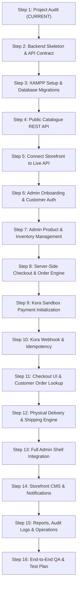

# Project Audit & Technical Gap Analysis

> [!NOTE]
> **Historical document.** This is the Step 1 gap analysis written before the build. Much of what it
> describes (mock data, the single-page admin, the helpdesk dashboard) no longer exists. For the
> current system see the root [README](../README.md); for what the later full audit found and fixed,
> see the summary below and the git history of the `audit-fixes` branch.

## Audit fixes (October 2026)

| Phase | Commit | What changed |
| :--- | :--- | :--- |
| 0 | `de171d1` | Baseline snapshot; `.gitignore` for logs, uploads and secrets; secrets removed from docs. |
| 1 | `750c700` | Security: no dev admin token, cookie-only sessions (hashed), customer-only magic links that are never returned by the API, CSRF, MySQL rate limiting, safe guest order lookup, upload hardening, same-origin API proxy. |
| 2 | `c2571a3` | Money: one payment finaliser (amount/currency checks, idempotent, never moves an order backwards, flags late/duplicate/under/over-payments), Monnify signature required, stock reservation expiry, idempotent orders, exact variants, promo counted once, safe refunds, re-entrant transactions, variant upserts. |
| 3 | `256fb2c` | Storefront: real variants and prices, honest product data, cart cleared only after verified payment, URL-driven catalogue with real filter options, guest orders linked on sign-in. |
| 4 | `95a37d7` | Admin rebuilt on real routes with login/setup, real dashboard figures, order detail and fulfilment, delivery-zone editor, refunds with limits, promo dates, settings that take effect, opt-in newsletter with unsubscribe, pagination everywhere. |
| 5 | `91e9a6a` | Outbox-first email with retries and an honest SMTP status, analytics from verified money, consistent audit log. |
| 6 | `e95872b` | Storefront content made honest (no invented stats, brands, reviews or countdowns), moderated reviews, real flash-deal end times, information pages, accessibility pass. |
| 7 | latest | Test runner on a throw-away database, suites in `backend/tests/`, docs rewritten. |

---

> **Generated as part of Step 1 of the E-Commerce System Implementation Blueprint.**  
> **Status:** Completed  
> **Target Stack:** Next.js 14 (Frontend) + PHP 8+ (MySQLi REST API Backend) + MySQL (Local XAMPP) + Kora (Korapay) Sandbox  
> **Confirmed Parameters:** Currency: `NGN (₦)` | Environment: `Standard XAMPP (http://localhost/)` | Store Origin: `Enugu, Nigeria`

---

## 1. Inventory of Routes and Reusable Components

### 1.1 Next.js 14 App Router Routes

The storefront and administration interfaces are organized under the `app/` directory:

| Route Path | Type | File Location | Purpose & Current Behavior |
| :--- | :--- | :--- | :--- |
| `/` | Page (Static) | `app/page.tsx` | Main landing page: renders Hero Banner, Brand Bar, Flash Deals, Category Grid, Product Sections (New Arrivals / Top Selling), Browse by Dress Style, and Customer Reviews. Currently powered by `data/mockData.ts`. |
| `/_not-found` | Page (Static) | `app/_not-found.tsx` | Global 404 page for unmatched storefront URLs. |
| `/category` | Page (Static) | `app/category/page.tsx` | Product catalog with desktop filter sidebar, mobile filter drawer, pagination, price range slider, category filters, and dress style filters. Filter logic runs purely client-side against `mockData.ts`. |
| `/products/[id]` | Page (Dynamic) | `app/products/[id]/page.tsx` | Product detail page featuring multi-image gallery with zoom preview, variant selector (colors, sizes), quantity stepper, interactive tabs (Reviews, Product Details, FAQs), and recommended product carousel. |
| `/cart` | Page (Static) | `app/cart/page.tsx` | Shopping cart page displaying line items with quantity adjustments, item deletion, promo code input, order summary calculations, and Express Checkout modal trigger. |
| `/admin` | Page (Static) | `app/admin/page.tsx` | Administration dashboard shell. Renders Kravio admin header, metrics row, trend bar chart, SLA monitoring table, and activity feed. |
| `layout.tsx` | Global Layout | `app/layout.tsx` | Root shell providing fonts (`Integral CF`, `Satoshi`), metadata, `CartProvider`, `WishlistProvider`, global `Header`, `Footer`, `WishlistDrawer`, and `StoreShell`. |
| `admin/layout.tsx` | Admin Layout | `app/admin/layout.tsx` | Scoped layout for the `/admin` route; isolates admin dashboard views and suppresses customer storefront header/footer. |

### 1.2 Reusable Component Inventory

The project features 33 modular React components structured by domain:

#### Layout Components (`components/layout/`)
- `Header.tsx`: Top navigation bar with promotional banner toggle, category dropdown, live product search preview (with outside-click dismissal), interactive user profile dropdown with Admin link, wishlist icon with live counter, and shopping cart counter. Includes responsive mobile drawer.
- `Footer.tsx`: Brand statement, social media links, multi-column navigation links (Company, Help, FAQ, Resources), newsletter subscription form, and payment badge row.
- `StoreShell.tsx`: Dynamic layout wrapper that suppresses public header and footer when viewing `/admin`.
- `WishlistDrawer.tsx`: Slide-out panel displaying saved wishlist items with direct "Move to Cart" and "Remove" actions.

#### Catalog Components (`components/catalog/`)
- `FilterSidebar.tsx`: Sticky desktop sidebar housing category checkboxes, price range slider, color swatch selectors, size pills, and dress style options.
- `FilterDrawer.tsx`: Responsive bottom/slide-out modal version of the filter sidebar for mobile viewports.
- `FilterContent.tsx`: Shared filter controls rendered identically inside both sidebar and drawer.
- `ProductGrid.tsx`: Responsive grid container with active filter chips, sort dropdown, product cards, pagination controls, and empty-state filter reset.

#### Product Detail Components (`components/product/`)
- `ImageGallery.tsx`: Main product image display with interactive thumbnail strip, image zoom preview modal, and out-of-bounds index safeguards.
- `VariantSelector.tsx`: Interactive color radio swatches with checkmark indicators and size selector pills.
- `ProductTabs.tsx`: Tabbed container managing customer reviews (with star ratings and date stamps), technical product specifications, and FAQs.
- `StickyMobileBar.tsx`: Mobile viewport bottom bar with live price, quantity controls, and persistent "Add to Cart" button.

#### Cart & Checkout Components (`components/cart/`)
- `CartItemList.tsx`: Itemized cart list displaying product thumbnails, variant details (color/size), unit price, subtotal, and quantity steppers with trash deletion.
- `OrderSummary.tsx`: Financial summary calculating subtotal, discount amount, location delivery fee, and grand total. Contains promo code form and "Go to Checkout" CTA.
- `CheckoutModal.tsx`: Modal overlay collecting shipping address (Name, Email, Address, City, Country) and simulated card payment.

#### Home Sections (`components/home/`)
- `HeroBanner.tsx`: Hero section featuring high-impact typography, stat counters (200+ Brands, 2,000+ Products, 30,000+ Happy Customers), and optimized hero imagery.
- `BrandBar.tsx`: Responsive marquee banner showcasing brand logos (Versace, Zara, Gucci, Prada, Calvin Klein).
- `CategoryGrid.tsx`: Visual cards linking directly to filtered category views.
- `FlashDeals.tsx`: Countdown deal section highlighting high-discount products with animated badges.
- `ProductSection.tsx`: Reusable grid layout for "New Arrivals" and "Top Selling" products with "View All" actions.
- `BrowseByDressStyle.tsx`: Bento-grid layout for styles (Casual, Formal, Party, Gym).
- `CustomerReviews.tsx`: Testimonial carousel with star ratings and verified customer badges.

#### UI Primitives & Utilities (`components/ui/`)
- `ProductCard.tsx`: Standard card with image lazy loading, discount percentage badges, star ratings, price comparison, and hover wishlist button.
- `Toast.tsx`: Animated notification toast for cart actions.

#### Kravio Admin Components (`components/admin/`)
- `AdminHeader.tsx`: Top bar with global search (`CMD+K`), period filter (`last-week`, `last-month`, `last-quarter`), date display, notification bells, and admin profile card.
- `AdminSidebar.tsx`: Collapsible navigation sidebar with search, accordion navigation groups, and icon helpers.
- `AdminCard.tsx`: Card container with decorative SVG pattern headers.
- `MetricsRow.tsx`: Grid of 3 KPI metric cards with period-over-period percentage delta badges.
- `TrendBarChart.tsx`: Day-by-day interactive bar chart with tooltip hover metrics.
- `SlaMonitoringTable.tsx`: Data table with status pills, priority indicators, and assignee avatars.
- `ActivityFeed.tsx`: Chronological timeline of operational events.
- `AnimatedNumber.tsx`: Smooth digit transition wrapper.
- `AdminIcon.tsx`: Internal SVG icon resolver for Kravio design tokens.

---

## 2. Real vs. Mocked Behaviour Matrix

| Feature Domain | Existing Storefront Implementation | Target Backend / Real Implementation | Required Migration |
| :--- | :--- | :--- | :--- |
| **Catalog Data** | Static fixtures in `data/mockData.ts` (`PRODUCTS`, `CATEGORIES_LIST`, `DRESS_STYLES`). | MySQL database tables (`categories`, `products`, `product_variants`, `product_images`). | Migrate fixtures to SQL seed scripts; fetch via PHP REST endpoints (`/api/v1/products`). |
| **Product Variants** | Hardcoded variant arrays (colors, sizes) embedded inside product objects. | Normalized `product_variants` table tracking SKU, size, color, stock quantity, and price overrides. | Storefront variant selector connects to server variant IDs. |
| **Product Inventory** | Simulated boolean flag or arbitrary numeric stock. | Transaction-safe `stock_quantity` decremented upon order creation and verified at checkout. | Implement row-level locking (`SELECT ... FOR UPDATE`) in PHP order creation. |
| **Pricing Calculation** | Client-side in `CartContext.tsx` via `subtotal - discount + deliveryFee`. | Authoritative server-side calculation via `POST /api/v1/checkout/quote`. | Client sends only product/variant IDs and quantities; backend calculates totals. |
| **Discounts & Promos** | Hardcoded in `data/mockData.ts` (`PROMO_CODES`); auto-applies `SHOP20`. | Database-backed `promotions` table with expiration dates, usage limits, and validation. | Backend checks code validity; removes auto-applied client discount. |
| **Delivery Fees** | Hardcoded `$15` flat fee in `CartContext.tsx` whenever `items.length > 0`. | Location-based PHP fee engine matching customer address to configured `shipping_zones` (Origin: Enugu). | Fetch shipping zones dynamically; reject or quote unmatched zones; never default to free. |
| **Checkout Flow** | `CheckoutModal.tsx` simulates success with fake card number and `canvas-confetti`. | Multi-step hosted checkout with **Kora Sandbox** redirect; payment verification via webhook. | Replace fake modal submit with `POST /api/v1/checkout/initialize-payment` and redirect to Kora. |
| **Customer Auth** | No authentication; anonymous browsing and checkout. | Guest-first checkout linked to customer profile; passwordless magic link / email verification. | Add `users`, `email_verification_tokens`, and secure session cookies in PHP. |
| **Customer Orders** | Clears cart and drops data upon simulated checkout. | Database records in `orders`, `order_items`, `order_status_history`; tokenized guest lookup. | Build customer `/me/orders` and guest order tracking page (`/order-lookup`). |
| **Admin Operations** | Static metrics in `data/adminData.ts` modeling IT support tickets. | Real queries against `orders`, `payments`, `products`, and `users` for the 18 e-commerce domains. | Replace ticket data with real e-commerce KPIs (Gross/Net sales, AOV, order volume). |

---

## 3. Cart & Wishlist Data Shape and Persistence

### 3.1 Cart Context (`context/CartContext.tsx`)

#### Current Data Structure:
```typescript
export interface CartItem {
  id: string;              // Compound string: `${productId}-${size}-${colorName}`
  productId: string;       // Foreign key to mock product
  name: string;
  slug: string;
  price: number;           // Untrusted client-stored price
  originalPrice?: number;
  image: string;
  size: SizeType | string;
  color: ProductColor;
  quantity: number;
}
```

#### Persistence Mechanism:
- Cart items are serialized to browser `localStorage` under the key `shopco_cart`.
- **Hydration Flaw**: When `localStorage` is empty, the context re-seeds itself with 3 hardcoded mock items (`gradient-graphic-tshirt`, `checkered-shirt`, `skinny-fit-jeans`).
- **Financial Flaw**: Subtotal, discount amount, and delivery fee are computed client-side. The delivery fee is hardcoded to `15` and `SHOP20` (20% off) is applied by default.

#### Reconciliation & Backend Alignment:
1. Remove default seeded items: fresh sessions must initialize with an empty array `[]`.
2. Ensure prices in `CartItem` are treated as display-only hints; the checkout submission will send only `{ variant_id, quantity }`.
3. Guest carts remain in `localStorage` until checkout; upon email verification or customer login, the frontend invokes a merge endpoint `POST /api/v1/cart/merge` to associate items with the server customer profile.

### 3.2 Wishlist Context (`context/WishlistContext.tsx`)

#### Current Data Structure:
- Stores an array of `Product` objects in `localStorage` under key `shopco_wishlist`.
- Provides `addToWishlist`, `removeFromWishlist`, `isInWishlist`, and `toggleWishlist`.

#### Reconciliation & Backend Alignment:
- Mirror the cart model: persist locally for guests, synchronize with backend `wishlists` table upon authenticated sign-in.

---

## 4. Existing Admin Navigation, Dead Links and Adaptation Map

### 4.1 Current Kravio Admin Navigation Audit

The current admin sidebar in `components/admin/AdminSidebar.tsx` and `data/adminData.ts` implements navigation for an IT service desk:

| Existing Nav ID | Label | Sub-items | Current Status in `app/admin/page.tsx` |
| :--- | :--- | :--- | :--- |
| `overview` | Overview | None | **Partially Functional**: Switches active state, displays mock KPI cards and trend chart. |
| `tickets` | Tickets | `queue`, `sla-risk`, `escalations` | **Partially Functional**: Accordion expands, displays `SlaMonitoringTable`. |
| `clients` | Clients | None | **Dead Action**: Clicking sets state but view remains empty or unchanged. |
| `agents` | Agents & Teams | `all-agents`, `teams`, `schedules` | **Dead Action**: Clicking sets state but renders no sub-view. |
| `kb` | Knowledge Base | `articles`, `categories` | **Dead Action**: Renders no sub-view. |
| `integrations` | Integrations | None | **Dead Action**: Renders no sub-view. |
| `sla` | SLA Compliance | None | **Dead Action**: Renders no sub-view. |
| `csat` | CSAT & NPS | None | **Dead Action**: Renders no sub-view. |
| `workload` | Workload Analytics | None | **Dead Action**: Renders no sub-view. |
| `reports` | Reports | None | **Dead Action**: Renders no sub-view. |
| `feedback` | Feedback | None | **Dead Action**: Renders no sub-view. |
| `help` | Help & Support | None | **Dead Action**: Renders no sub-view. |
| `settings` | Settings | None | **Dead Action**: Renders no sub-view. |

### 4.2 Adaptation Map to 18 E-Commerce Administrative Domains

Per Section 8 of `ECOMMERCE_COMPLETE_SYSTEM_PLAN_UPDATED.md`, the Kravio shell will be systematically remapped to real e-commerce operations:

```
Existing Support Ticket Structure            Target E-Commerce Architecture
├── Overview (Tickets/SLA)            ───►   1. Overview (Gross/Net Sales, Orders, Low Stock)
├── Tickets Queue                     ───►   2. Orders (Pending, Paid, Shipped, Delivered, Cancelled)
├── Clients                           ───►   3. Customers (Spend history, orders, status)
├── [New Domain]                      ───►   4. Products (Physical CRUD, Variants, Stock)
├── [New Domain]                      ───►   5. Categories (Hierarchy, Status, Slugs)
├── [New Domain]                      ───►   6. Inventory (Adjustments, Stock Movement Logs)
├── [New Domain]                      ───►   7. Payments (Kora References, Transactions, Webhooks)
├── [New Domain]                      ───►   8. Refunds (Manual/Provider Refund Records)
├── [New Domain]                      ───►   9. Promotions (Coupons, Percentages, Limits)
├── Integrations                      ───►   10. Storefront CMS (Hero Banners, Flash Deals)
├── [New Domain]                      ───►   11. Shipping & Fulfilment (Enugu Origin, Delivery Zones)
├── Workload / Reports                ───►   12. Analytics & Reports (AOV, Top Products, CSV Export)
├── Agents & Teams                    ───►   14. Admin Account (Single Admin Credentials, Lockout Status)
├── [New Domain]                      ───►   15. Notifications (Email Outbox, Retry Logs)
├── [New Domain]                      ───►   16. Audit Logs (Actor, Entity, Before/After Snapshot)
├── Settings                          ───►   17. Settings (Store Address, Currency NGN, Kora Mode)
└── Help & Support                    ───►   18. System Status / Health (API & DB Health Check)
```

---

## 5. Current Styling Conventions and Asset Inventory

### 5.1 Typography
- **Heading Font**: `Integral CF` (defined via class `font-integral` in `app/globals.css`). Used for high-impact hero headings, section titles, and Shop.co branding.
- **Body Font**: `Satoshi` (defined via class `font-satoshi` in `app/globals.css`). Used for product descriptions, navigation links, and body copy.
- **Admin Font**: `Space Grotesk` (defined via class `font-space` in `app/globals.css`). Used for admin metrics, tables, and numeric data displays.

### 5.2 Color Tokens & UI Guidelines
- **Storefront Neutrals**: Pure black (`#000000`), Dark Charcoal (`#1F2937`), Light Neutral background (`#F0F0F0` / `#F2F0F1`).
- **Accent Tokens**: Red Sale Badge (`#DC2626` / `text-red-600`), Gold Star Rating (`#FFC633`).
- **Admin Tokens**: Slate borders (`#E5E7EB`), Dark text (`#1F2937`), subtle gray background (`#F9FAFB`).

### 5.3 Currency Migration Plan
- Currently, storefront prices are rendered with a dollar sign prefix (e.g., `$145`, `$240`).
- The project is confirmed for **NGN (`₦`)** (Nigerian Naira).
- A centralized currency formatting utility `formatCurrency(amount: number)` will be implemented in `lib/utils.ts` to output `₦145,000` or standard Naira formatting across all storefront cards, detail views, cart summaries, and admin reports.

---

## 6. Package Scripts and Baseline Build Status

### 6.1 Package Configuration (`package.json`)
```json
{
  "name": "shop-co-ecommerce",
  "version": "1.0.0",
  "private": true,
  "scripts": {
    "dev": "next dev",
    "build": "next build",
    "start": "next start",
    "lint": "next lint"
  }
}
```

### 6.2 Baseline Build Verification Results
Execution of `npm run build` on Next.js 14.2.35 executed with **zero errors**:

```text
> shop-co-ecommerce@1.0.0 build
> next build

  ▲ Next.js 14.2.35

   Creating an optimized production build ...
 ✓ Compiled successfully
   Linting and checking validity of types ...
   Collecting page data ...
   Generating static pages (0/7) ...
   Generating static pages (1/7) 
   Generating static pages (3/7) 
   Generating static pages (5/7) 
 ✓ Generating static pages (7/7)
   Finalizing page optimization ...
   Collecting build traces ...

Route (app)                              Size     First Load JS
┌ ○ /                                    5.7 kB          118 kB
├ ○ /_not-found                          141 B          87.4 kB
├ ○ /admin                               11.9 kB         108 kB
├ ○ /cart                                8.1 kB          121 kB
├ ○ /category                            5.41 kB         118 kB
└ ƒ /products/[id]                       6.07 kB         119 kB
+ First Load JS shared by all            87.3 kB
  ├ chunks/117-67099e47be104ef6.js       31.7 kB
  ├ chunks/fd9d1056-86bacdcf9105a5f7.js  53.6 kB
  └ other shared chunks (total)          1.89 kB

○  (Static)   prerendered as static content
ƒ  (Dynamic)  server-rendered on demand

Exit Code: 0 (SUCCESS)
```

---

## 7. Analysis of Blueprint Conflicts & Missing Integrations

### 7.1 Conflict with Legacy `PRODUCTION_BLUEPRINT.md`
The repository history previously contained a `PRODUCTION_BLUEPRINT.md` outlining a stack based on **Stripe Elements, Redis sliding-window locks, Cloudflare WAF, and microservices**. 

**Formal Resolution**: That document is completely superseded by `ECOMMERCE_COMPLETE_SYSTEM_PLAN_UPDATED.md` and `INSTRUCTIONS.md`. The project strictly adheres to:
1. **PHP 8+ REST API with MySQLi** (Native prepared statements, no Laravel, no second Node server).
2. **Kora (Korapay) Sandbox** (Hosted checkout, HMAC webhook verification, no raw card handling).
3. **MySQL via Local XAMPP** (InnoDB tables, transactions, foreign keys, utf8mb4).
4. **Redis Deferred**: All idempotency, locks, and session states are managed using MySQL transactions, row-level locks (`FOR UPDATE`), and deduplication tables.

### 7.2 Missing Backend & Infrastructure Components
To achieve a functional full-stack application, the following components must be built in subsequent steps:

1. **Backend Skeleton (`backend/`)**:
   - Single document root (`backend/public/index.php`).
   - Modular structure: `Config`, `Database`, `Middleware`, `Controllers`, `Services`, `Repositories`, `Validators`, `Payments/Kora`.
   - `.env` loader, CORS allowlist, and health check endpoint `/api/v1/health`.
2. **Database Migrations (`backend/migrations/`)**:
   - Schema definitions covering identity, catalog, variants, orders, payments, webhook events, delivery zones, and audit logs.
3. **Single Admin Onboarding Flow**:
   - Protected setup endpoint capturing admin credentials and the store origin address in **Enugu, Nigeria**. Permanent lockout once initialized.
4. **Location-Based Shipping Zone Engine**:
   - Zone lookup matching customer delivery location to configured delivery zones; calculating and returning authoritative fees.
5. **Kora Sandbox Payment Gateway**:
   - Hosted checkout initialization (`/checkout/initialize-payment`).
   - HMAC SHA256/SHA512 webhook signature validator with idempotent processing.

---

## 8. Recommended Smallest-Change Implementation Sequence

To maintain continuous stability and avoid breaking the existing Next.js frontend, work will proceed strictly one prompt at a time across the 16 defined stages:



---

## 9. Conclusion
The frontend is structurally solid, visually polished, and builds with zero errors. All mock behaviors, client-side pricing shortcuts, and admin gaps have been documented with precision. 

The project is fully prepared to begin **Step 2 — Create backend skeleton and API contract**.
