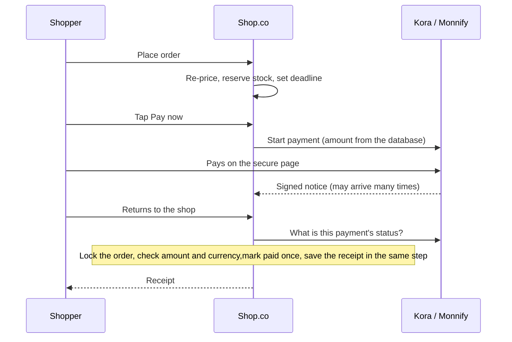

[SHOP.CO](#top)

[Shoppers](#shoppers) [Store owners](#owners) [Safeguards](#safeguards) [Scale](#scale) [How it works inside](#inside) [Roadmap](#roadmap) [FAQ](#faq) [Live store ↗](https://shopco.kharizdigital.com.ng) [Admin ↗](https://shopco.kharizdigital.com.ng/admin)

Online clothing store for Nigeria · prices in ₦ · delivery to all 36 states and FCT

# A store that *never oversells* and never charges twice.

Shop.co is a complete, ready-to-launch online store. Shoppers buy as guests or with an account and pay by card or bank transfer through Kora or Monnify, or by a transfer arranged on WhatsApp. The owner runs products, stock, orders, shipping, refunds, promotions and reports from one panel. Under the hood it is engineered like a much bigger system, and every claim on this page is backed by an automated test or a measured load test.

[Open the live store ↗](https://shopco.kharizdigital.com.ng) [Open the admin panel ↗](https://shopco.kharizdigital.com.ng/admin)

Guest checkout Kora & Monnify WhatsApp transfers Delivery fees by state Order tracking Full admin panel Staff accounts Daily backups

**20 of 20**100 buyers at the same instant for 20 items: exactly 20 sold, none oversold

**990 → 200**990 payment notices for 200 paid orders: each paid once, one receipt each

**3,481**orders in 3 minutes of continuous checkout, with 0 errors

**1,900+**automated checks pass before every release

For shoppers

## From browsing to the front door

Every step is designed for phones first, works by keyboard, and never shows made-up products, prices or reviews.

Try it yourself: [shopco.kharizdigital.com.ng](https://shopco.kharizdigital.com.ng). Payments on the demo are in test mode, so no real money moves.

1. ### Arrive

   A homepage built on the server for a fast first view: rotating banners set by the owner, a promo code shown beside the banner's button, flash deals with a real countdown, a Featured row the owner picks, new arrivals, top sellers ranked by paid orders, categories with real counts, and approved reviews marked "Verified purchase" when the shop found a paid order. A page that is already open picks up the owner's changes within seconds.
2. ### Find

   Search suggests products as you type and understands word beginnings; a search that finds nothing says so and offers a way on. The catalogue sorts by best selling, newest, price or rating, and filters by category, price, colour (named, with smart families, so "blue" also finds navy), size, style and offers. Only filters that match something are shown, and every filter lives in the link, so it can be shared.
3. ### Choose

   The product page shows the price of the exact size and colour picked, offers only the sizes in stock in that colour, and states stock honestly. Changing colour never swaps the chosen size behind the shopper's back. Star ratings start from a rating the owner sets and follow real reviews as they come in; the review count shown is always the real one.

   "Only 3 left in this size."
4. ### Cart

   Each line is one exact option. Signed-in carts follow the shopper across devices and merge on sign-in without doubling anything. Each visit re-checks prices and stock and says exactly what changed. Promo codes apply instantly and are re-checked as the cart changes. A wishlist keeps items for later, each with its own Add to cart button.

   "Only 2 left of Denim Jacket (M); quantity updated."
5. ### Delivery

   Pick a state and the server re-prices every item, checks stock, finds the delivery zone and its fee (which can grow with the number of items), applies the code and returns the totals. A state the store doesn't serve is refused clearly. A free delivery is never applied by mistake. The shopper can share a map pin to help the rider find them, and a signed-in customer's saved address is filled in for them.
6. ### Reserve

   Placing the order reserves the items at once, for the payment window the owner sets (60 minutes by default for online payment). A double click or a dropped connection returns the same order, never a second one. Going back to change the delivery details before paying releases the items straight away.

   "Order ORD-20261030-A1B2C3 is reserved until 14:35."
7. ### Pay

   Two clear buttons instead of a list of gateways, each switched on or off by the owner. Card details are entered only on the provider's page, and the amount sent always comes from the database.

   Automatic**Pay now**

   Card or bank transfer on the secure page of the gateway the owner chose, Monnify or Kora. Confirmed by the gateway's signed notice and by asking the gateway directly.

   Owner confirms**Pay via WhatsApp**

   A chat opens with the order number and amount filled in. The shopper pays by transfer and taps "I've sent the transfer". The order is held for 24 hours by default, and the owner confirms it by its bank reference.

   Reserved**Pay later**

   The order keeps its items until the deadline. The shopper can come back and pay from the cart, or from Track order on any device with the order number and checkout email.
8. ### Confirmed

   The return page asks the payment provider directly, re-checks automatically while a transfer clears, then shows a receipt to view, print or save. After "I've sent the transfer" it shows "Awaiting confirmation", and the receipt appears by itself the moment the owner confirms. The paid items leave the cart exactly once. Failed, expired and late payments each get a plain explanation and a next step.

   "Payment didn't go through. No money was taken for this attempt."
9. ### Track

   Track any order by order number or courier tracking number, with a five-step progress bar from "Order placed" to "Delivered", the courier's tracking link, and the receipt for a paid order. Emails at every step: order received, payment received, being prepared, shipped, delivered, cancelled, refunded. Guest orders join the customer's history automatically when they later sign in with an email link.

For store owners

## The whole store in one panel

An alert bell shows what needs the owner: transfers customers say they've paid, payments that need attention, and the database's health. New orders and payments are also emailed to the address the owner chooses. Risky actions ask first. Every change is logged.

### Try the admin panel

- **Address:** [shopco.kharizdigital.com.ng/admin](https://shopco.kharizdigital.com.ng/admin)
- **Email:** khariz.digital@gmail.com
- **Password:** XMtMf2B-KehcsZA

This is a demo store with sample data, so look around freely. Payments are in test mode, and the store itself is at [shopco.kharizdigital.com.ng](https://shopco.kharizdigital.com.ng).

### Overview

Net sales, paid orders, average order value with trends; a sales chart from verified payments; a live feed of new orders, failed payments and low stock; tiles for what to ship and what needs attention.

### Orders

Search by order, email, name or tracking number; filters for every stage; CSV export. The list refreshes by itself, so new orders appear without reloading. The server enforces the order lifecycle: "paid" only comes from a confirmed payment, "refunded" only from a recorded refund.

### Shipping

A queue of paid and processing orders to pack that refreshes by itself, one-click ship with courier and tracking (the customer is emailed), and delivery zones per group of states, with fees that can grow with the number of items and a warning for states not covered.

### Products & stock

Products with sizes and colours, each with its own SKU, price, stock and low-stock alert. A product can be featured on the home page, put in a flash deal and given a starting star rating. Photos are checked, shrunk and stripped of location data. Stock adjustments carry a reason and are logged.

### Payments & refunds

Every payment attempt with received and expected amounts side by side. Refunds are recorded after the money is sent and can never exceed what was paid, even when two are recorded at once.

### Customers

Lifetime orders and verified spend, saved addresses, recent orders. Suspending a customer signs them out everywhere without touching their orders.

### Promotions & newsletter

Promo codes by percentage or fixed amount, with a minimum order, a maximum discount, dates and limits; one can be shown on the home page. Uses are counted once and returned when an order is cancelled. Newsletters go to subscribers and to customers with a confirmed email or a paid order, at most once per person per day, with one-click unsubscribe.

### Banners & reviews

Homepage banners with checked links, and review moderation. Only approved reviews show, and they steadily take over from a product's starting rating.

### Analytics

Any date range; sales by day, product, category and payment gateway; refunds owed; formulas explained in plain words; CSV downloads protected against spreadsheet tricks.

### Audit log

Who changed what, with before and after values, IP and browser, across 40+ kinds of action. Passwords and keys are blanked out, and a deleted admin's name stays on what they did.

### Data & storage

Keep periods chosen by the owner. Nothing is ever deleted automatically: old data is listed for review, and deleting needs the owner's password and a one-time code emailed to them.

### System status

Live health of the database, storage, email, payment gateways, order queues and server settings, with warnings to fix before customers arrive. Technical pages stay out of the way until the owner turns on dev mode with their password.

### Admin team

Add a staff admin in a click (a password can be made up and shown once), switch one off or delete one, each confirmed with your own password. The first account is the Owner, whom staff can never switch off or delete.

### Search & speed

A search box finds any order, customer or product from every screen. Screens open at once from memory and refresh behind the scenes, and switches change the moment they are clicked. A mini sidebar of icons gives more room, and there is a dark mode.

### Store settings

Store details and support contacts, the brand strip, which gateway "Pay now" uses and each payment method on or off, where admin alerts are emailed, and the default star rating for products.

Built not to break

## Every risk, planned for and proven

These are the ways online stores usually fail. Each one was designed against and tested.

| Risk | What this store does | Proof |
| --- | --- | --- |
| Overselling | Stock is reduced only if enough is left, inside the order's own database step | 100 buyers, 20 units: exactly 20 sold |
| Double orders | One unique key per checkout; a repeat returns the same order | Automated tests |
| Double charges | One gate for every payment confirmation, with the order locked; repeat notices ignored | 990 notices → 200 orders paid once |
| Fake payment notices | Each notice must carry the provider's secret signature | Bad signatures refused in tests |
| Price tampering | Every price, fee, discount and total is recalculated on the server | Automated tests |
| Under-, over- and late payments | Flagged on the order with a plain explanation, never silently accepted | Load test and tests |
| Slow-clearing payments | The payment providers are asked before an unpaid order is cancelled; open card or transfer payments get 30 extra minutes | Automated tests |
| Stock stuck in abandoned checkouts | A payment deadline releases the stock and promo use exactly once | Automated tests |
| Lost or duplicate emails | Emails are saved in the same step as the change they announce, retried, and claimed before sending | 20,000 emails, 4 workers, each sent once |
| A slow email service | Emails go out after the shopper already has their answer | Load test |
| Newsletter sent twice | At most once per person per day; recipient count confirmed | Automated tests |
| Newsletter to people who never asked | Only subscribers and customers with a confirmed email or a paid order; a customer's unsubscribe can't be undone by anyone else | Automated tests |
| Password and code guessing | Limits on sign-in, sign-in links, promo codes, order lookups, reviews and orders; five wrong tries lock every admin password check for 15 minutes | Automated tests |
| Cross-site tricks | A security token on every change; cookies page scripts can't read | Automated tests |
| Harmful picture uploads | Real image types only, 5 MB limit, location data removed | 50 uploads at once, all safe |
| Accidental data deletion | Nothing deleted automatically; password plus emailed code plus a fresh review | Automated tests |
| Data loss | Daily backups with a checksum, copied off the server; restore only into a new database, verified row by row | Restore tested on every test run |
| Refunding too much | Refundable balance checked with the payment locked | Automated tests |
| "Who changed this?" | Full audit log with before and after values | Automated tests |
| Staff locking the owner out | The first account is the Owner; only an owner can switch off or delete an owner, and the last active admin can never be removed | Automated tests |
| The wrong size in the cart | Changing colour never swaps the chosen size; only sizes in stock are offered | Automated tests |

Built to grow

## Measured, not guessed

Load-tested on a modest 4-core PC running the store, its database and the test traffic together, with 4,000 products, 8,500 sizes and colours, 2,000 customers and 5,000 past orders. A real server does better. p95 means 95 out of 100 requests were at least this fast.

| Scenario | Result |
| --- | --- |
| 50 shoppers browsing at once | Pages p95 68–144 ms, catalogue answers p95 36–77 ms, 0 errors |
| 100 shoppers browsing at once | Pages p95 about 0.2 s, 0 errors |
| 30 buyers checking out non-stop for 3 minutes, 25 more browsing | 3,481 orders, 76 requests a second, order p95 0.3 s, 0 errors |
| 100 buyers at the same instant for 20 units | Exactly 20 sold, 0 oversold, p95 1.4 s |
| 990 payment notices in 13 seconds | 200 orders paid once each, 0 errors |
| Newsletter to 20,000 subscribers | Queued in 11 s; sent at the email service's pace |
| Browsing during a 20,000-email send | Only 19% slower (73 → 87 ms) |
| 200 never-seen picture sizes at once | All ready in 7.5 s; repeats 0.1–0.4 s |
| 64 customers watching live payment status at once, 4 more shoppers browsing | "Paid" within 2 s for every one, browsing p95 38 → 44 ms, 0 errors |

### How it grows

Stage 1

### One server

A hosting plan with PHP, MySQL and Node.js, or a small VPS. Launch here: the live demo runs on ordinary shared hosting.

Ready

Stage 2

### A bigger server

More CPU or a managed database for hundreds of shoppers at once. No code change.

Ready

Stage 3

### Several servers

Picture storage on Cloudflare R2 is already in use and a shared cache (Redis) is built in; a shared page cache comes next.

Mostly ready

Stage 4

### Live updates

"Paid" shows on the payment page about a second after the payment lands. Built and load-tested with 64 customers watching at once; switched on after a short check on the chosen host. A live admin bell comes later.

Built, off for now

How it works inside

## One gate for every payment

Provider notices, the shopper's return, the scheduled check and the owner's manual confirmation all pass through the same gate.

- **The order is locked while the gate works**

  Two notices arriving at the same moment are handled one after the other.
- **Amount and currency must match**

  Underpaid orders are not marked paid; overpaid ones are flagged for a refund; a wrong currency is not applied.
- **Repeats change nothing**

  A notice sent five times marks the order paid once.
- **Late or duplicate money is flagged**

  The owner sees a plain explanation instead of a silent mistake.
- **The receipt is saved in the same step**

  There is never a paid order without its receipt, or a receipt for a payment that didn't happen.
- **The database is the single source of truth**

  Caches only speed things up and are cleared the moment the owner changes anything. They are never trusted for money or stock.

Roadmap

## What comes next

An honest list, so nothing here is promised before it exists.

| Item | Status |
| --- | --- |
| Live payment status (instant "paid") | Built and load-tested; switched on after a short check on the chosen host. Until then the payment page re-checks automatically |
| Live admin alerts | Planned; today the alert bell, the orders list and the shipping queue refresh by themselves every minute |
| Pictures on Cloudflare R2 | Done: every picture on the live demo is served from R2 |
| Several admin accounts | Done: an Owner plus staff admins who can be added, switched off or deleted |
| Staff roles with limited access | Planned; today staff admins can do everything except remove the Owner |
| Admin password reset by email and two-step sign-in | Planned; data clean-ups already need an emailed code |
| Customer screens for saved addresses and profile | Planned; checkout already pre-fills the default address |
| Self-service returns form | Planned; returns are arranged by contacting the store |
| Newsletter double opt-in | Planned |
| Email to the owner for new orders and payments | Done: sent to every admin, or to the addresses set in Store settings |
| Real payments | The live demo takes Kora and Monnify payments in test mode, so no real money moves; the store's live keys go in before real customers |

Questions

## Client FAQ

Can customers pay by card and bank transfer?

Yes, through Kora and Monnify, plus bank transfers arranged on WhatsApp and confirmed by the owner with the bank reference.

Do customers need an account?

No. Guests can buy and track orders. An account adds a cart and wishlist that follow them across devices, and an order history.

What if two people buy the last item?

Only one gets it; the other is told it's sold out. This was tested with 100 buyers at the same instant.

What if a customer pays and closes the page?

The provider's signed notice and the scheduled check still confirm the payment, and the customer is emailed a receipt.

How are delivery fees set?

The owner groups states into delivery zones, each with a fee and an estimate, and the fee can grow with the number of items. States not covered are refused at checkout, never charged a guess.

Can I run sales?

Yes: promo codes by percentage or fixed amount (with a minimum order, a maximum discount, dates and limits), flash deals with countdowns, and "was" prices shown crossed out. One code can be advertised on the home page.

Can my staff have their own accounts?

Yes. Add a staff admin in a click, and switch one off or delete one when they leave. The first account is the Owner, and staff can never switch off or delete it. Every change each person makes is in the audit log under their name.

Can I choose the star ratings?

You can give a product a starting rating, or leave it to the store default. Real reviews take over as they come in, and the number of reviews shown is always the real number. Emptying the default shows stars from customer reviews only.

Has it taken real payments?

The live demo runs Kora and Monnify in test mode: checkout, the payment pages and automatic confirmation all work, and no real money moves. The store's live keys go in before real customers.

Is my customers' data safe?

Card details never touch the store. Sessions are secure, every change carries a security token, guessing is rate-limited, location data is removed from photos, and nothing is deleted without the owner's password and an emailed code.

What about backups?

Daily backups of the database, with a checksum, copied off the server to cloud storage, and a careful restore into a new database that is verified row by row. Pictures kept in cloud storage are copied back to the server each night. Step-by-step guides cover what to do when something goes wrong.

What hosting does it need?

PHP 8.2 or newer and MySQL for the store's server side, Node.js 20.9 or newer for the storefront, and scheduled jobs. A hosting plan with Node.js support or a small VPS is ideal. The [live demo](https://shopco.kharizdigital.com.ng) runs on an ordinary cPanel shared hosting plan.

What does it cost to run?

Hosting, the payment providers' fees and an email service. Picture storage on Cloudflare R2 is free up to 10 GB, and Redis is optional.

**Shop.co** · store guide, updated 11 November 2026.

Live store: [shopco.kharizdigital.com.ng](https://shopco.kharizdigital.com.ng) · Admin panel: [shopco.kharizdigital.com.ng/admin](https://shopco.kharizdigital.com.ng/admin)

Figures come from the store's automated test suite (1,847 server checks and 81 storefront tests) and a recorded load test on a development PC. They will be re-measured on the production host.